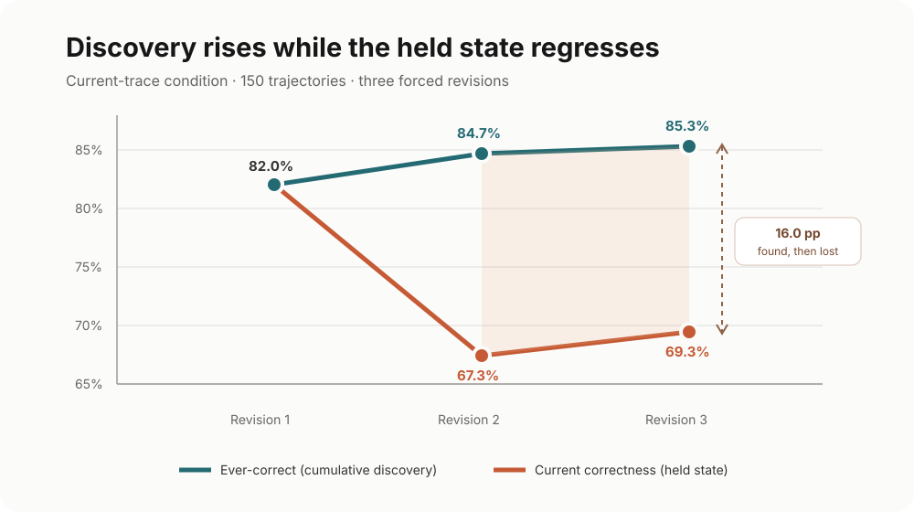
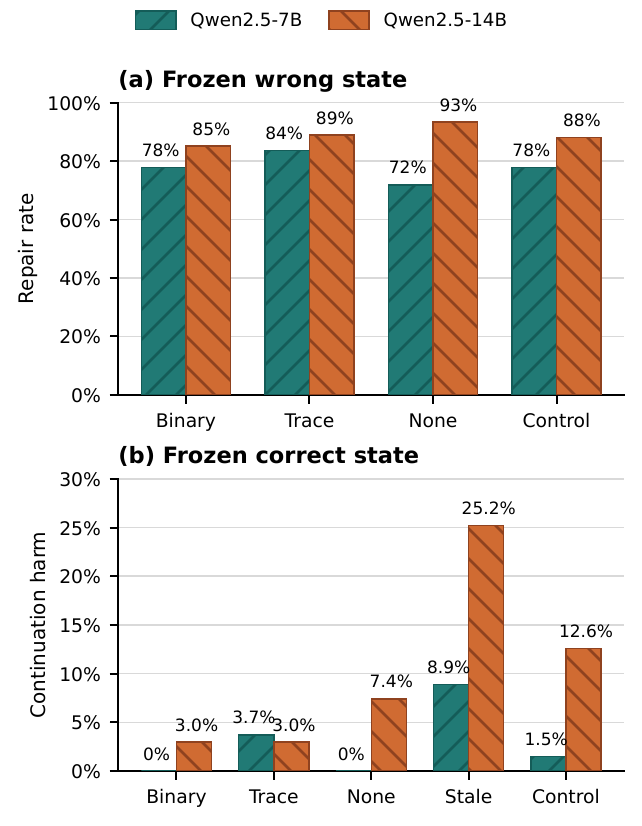
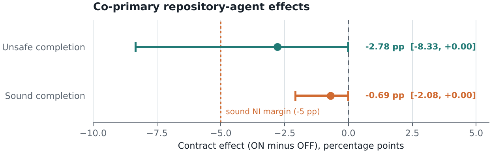
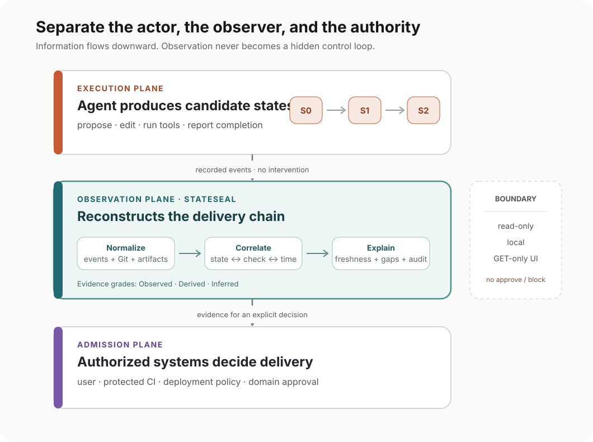
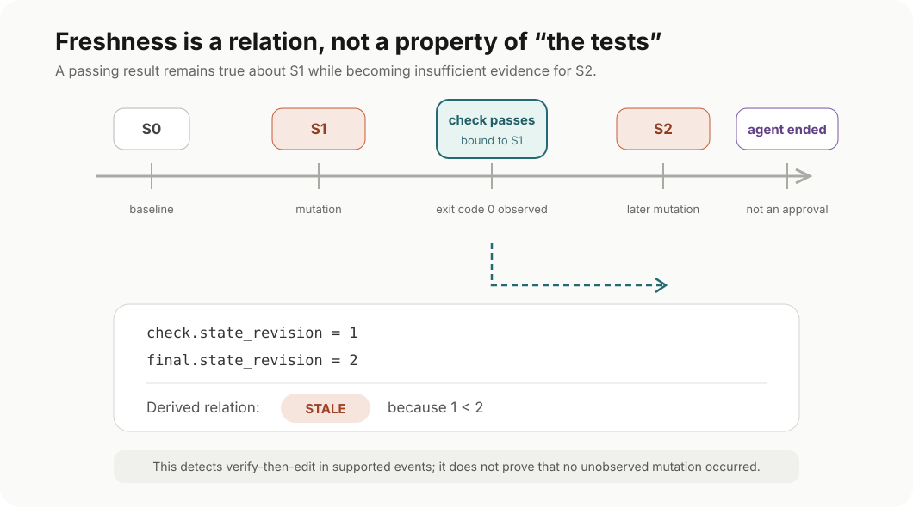

A coding agent produces a correct patch. The tests pass. Then the loop continues.

The next prompt contains a failure trace—but the trace came from an older version of the code. The model responds to the trace, edits the already-correct patch, and resurrects the bug. The final answer is wrong even though a correct answer existed one revision earlier.

Nothing exotic happened. The model followed feedback. The test really did pass. The trace contained valid input and output facts. Every individual step looked plausible when viewed alone.

The failure was in the transaction that connected them.

Coding agents are often organized around a loop:

```text
propose → execute → observe → revise → stop
```

Systems such as [Madaan et al. 2023](https://arxiv.org/abs/2303.17651), [Shinn et al. 2023](https://arxiv.org/abs/2303.11366), and the feedback-driven repair benchmark of [Dai et al. 2025](https://arxiv.org/abs/2504.06939) show why iteration is attractive: another attempt can discover a solution that the first attempt missed. Recent accounts of [test-time reasoning](https://lilianweng.github.io/posts/2025-05-01-thinking/) and [agent harness engineering](https://lilianweng.github.io/posts/2026-07-04-harness/) make the broader point that the workflow around a model—tools, context, persistent state, and evaluation—can matter as much as the model itself.

But discovery is not delivery.

In our 900-trajectory forced-revision study, the 150-trajectory current-trace arm exposed the distinction sharply. Current correctness fell from **82.0% after revision 1 to 67.3% after revision 2**, while the fraction of trajectories that had *ever* produced a correct patch rose to **84.7%**. By revision 3, **16.0%** of those trajectories had produced a correct patch and subsequently lost it ([Gao et al. 2026](https://arxiv.org/abs/2607.24604)).

The loop was getting better at finding answers and worse at retaining them.

This post develops a narrower claim than “agents need better tests” or “agents should stop earlier”:

> Iteration produces candidate states. Reliability depends on how a system observes, evaluates, preserves, and finally admits one of those states.

That claim has two consequences. First, evidence must be scoped to the state that produced it. Second, the component that explains the delivery chain should not automatically become another component that edits, blocks, or approves it.

<figure>
  <a href="figures/current-vs-ever.svg"></a>
  <figcaption>Figure 1. In the 150-trajectory current-trace condition, cumulative discovery improves while the state actually held by the loop regresses. By revision 3, 16.0% of trajectories had found a correct patch and later lost it. Data source: <a href="https://arxiv.org/abs/2607.24604">Gao et al. 2026</a>.</figcaption>
</figure>

## A Loop Produces Proposals, Not Reliability

Most code-generation metrics are search metrics.

**Pass@1** asks whether one sampled answer is correct. **Pass@k**, popularized for code generation by [Chen et al. 2021](https://arxiv.org/abs/2107.03374), asks whether at least one of several samples is correct; [Liu et al. 2023](https://arxiv.org/abs/2305.01210) later showed how weak test suites can overestimate that correctness. Best-of-$k$ adds a selector and therefore evaluates more than raw search, but it still normally treats candidates as separately preserved objects: candidate 4 does not overwrite candidate 2.

An iterative coding agent has a different failure surface. It edits one mutable workspace over time. Revision $S_{t+1}$ can repair $S_t$, but it can also erase it. A test result observed at time $t$ can remain in context after the code has moved to time $t+1$. A completion message can refer to a workspace that changed after the last check.

Two nearby benchmarks show why final pass/fail is too compressed. [Dai et al. 2025](https://arxiv.org/abs/2504.06939) report **63.6% repair success with mixed feedback** versus **57.9% with test feedback**, while gains diminish after two or three iterations. In a different repository-agent setting, [Sahoo et al. 2026](https://arxiv.org/abs/2605.12925) find that **10.7% of passing trajectories** in their process-assessable subset are “Lucky Passes,” with model-level rates ranging from **0.5% to 23.2%**. These are not directly comparable effect sizes—the tasks, agents, and denominators differ—but together they show that more useful feedback and a passing final patch do not identify whether the trajectory preserved progress cleanly. [Le et al. 2026](https://arxiv.org/abs/2607.01360) make the same measurement gap explicit by tracking targeted repair, generalization, and preservation under progressive hints.

Three quantities make the distinction visible:

- **Ever-correct**: did any revision in the trajectory satisfy the oracle? This measures cumulative discovery.
- **Current correctness**: is the workspace held at revision $t$ correct? This measures retention.
- **Sound completion**: did the system accept a result, and was the accepted result correct? This measures useful delivery.

The source paper separates five obligations that these metrics otherwise blur together:

- **Admission**: who may accept a candidate into a consequential target?
- **Preservation**: does a verified state survive later revisions and malformed actions?
- **Grounded certification**: does the completion claim carry fresh evidence for the exact delivered state?
- **Competence**: can the agent actually repair the defect under the available tools and budget?
- **Liveness**: does the policy still deliver useful work rather than merely abstaining safely?

These obligations interact, but none substitutes for another. The rest of this article follows their failure modes through state transitions, evidence, gates, and product boundaries.

They can move in opposite directions. Ever-correct can rise while current correctness falls. A gate can observe no false completions by accepting nothing, while sound completion falls to zero. An agent can discover a correct patch, overwrite it, and deliver the regression.

I find it more useful to call reliability a property of the **delivery transaction** than a personality trait of the model. A stronger model can improve proposal search. It does not by itself establish:

- which code state a test result describes;
- whether later edits invalidated that result;
- whether a passing state was retained;
- whether the delivered tree is the tree that was checked;
- or who has authority to turn an agent's completion claim into an accepted change.

Those are system properties.

The self-correction literature already warns against treating them as model personality. Intrinsic correction can fail without external signals ([Huang et al. 2024](https://openreview.net/forum?id=IkmD3fKBPQ); [Kamoi et al. 2024](https://doi.org/10.1162/tacl_a_00713)); locating an error is distinct from repairing a supplied location ([Tyen et al. 2024](https://aclanthology.org/2024.findings-acl.826/)); and refinement quality depends on verifier strength ([Zhang et al. 2024](https://aclanthology.org/2024.findings-acl.924/)). Our question starts one step later: once a good state exists, what keeps the surrounding transaction from losing or mis-certifying it?

## Correctness Is Not an Absorbing State

The smallest useful model of a revision loop has two transitions.

Starting from an incorrect state, another revision may repair it. Starting from a correct state, another revision may regress it. Let

$$
\alpha_e=P(Y_{t+1}=1\mid Y_t=0,e)
$$

be the repair probability under evidence condition $e$, and let

$$
\beta_e=P(Y_{t+1}=0\mid Y_t=1,e)
$$

be the regression probability. If $q_t=P(Y_t=1)$ is the population probability that the current state is correct, then

$$
q_{t+1}-q_t=(1-q_t)\alpha_e-q_t\beta_e.
$$

The first term is the expected gain from repairing wrong states. The second is the expected loss from damaging correct states. When $\alpha_e+\beta_e>0$, another revision has negative expected value when

$$
q_t>\frac{\alpha_e}{\alpha_e+\beta_e}.
$$

This threshold is an explanatory population result, not a deployable stopping rule by itself. A real system does not observe the latent correctness of the current patch, and neither $q_t$ nor the transition rates remain fixed when tasks, models, prompts, tools, or evidence policies change. Operational use would require a calibrated state estimator, uncertainty bounds, and drift monitoring. Without those, the equation tells us *why* deeper loops can hurt, not exactly when one individual run should stop.

Our forced-revision study was designed to expose the transition rather than imitate every adaptive production agent. Thirty HumanEval repairs were crossed with six evidence conditions and five seeds, producing 900 trajectories with three forced revisions each ([Gao et al. 2026](https://arxiv.org/abs/2607.24604)).

The result was not a generic depth penalty. With current binary feedback, correctness across the three revisions was **70.0%, 70.0%, and 72.0%**. With unavailable evidence it was **68.7%, 68.7%, and 70.7%**. With stale traces it moved **68.7%, 71.3%, and 66.0%**.

Depth merely creates more transition opportunities. Evidence and orchestration determine whether those transitions accumulate value or destroy it.

This also explains why “the model should know when to stop” is not a complete interface. A model's confidence or `DONE` token is still an observation about the model's intent. It is not proof that the final workspace is correct, that its last test is current, or that the model is authorized to approve its own output.

## Evidence Belongs to a State

A test report is not timeless knowledge.

Suppose revision $S_1$ fails a test, revision $S_2$ fixes it, and the model is then shown the failure trace from $S_1$. The payload may be factually valid: the input, expected output, and observed failure all really occurred. But it does not describe $S_2$.

For the purpose of revising $S_2$, the evidence is stale.

A minimal evidence envelope is

$$
E=(h_{state},h_{suite},execution\_id,payload).
$$

Here $h_{state}$ identifies the evaluated code state, $h_{suite}$ identifies the verifier suite and policy, and `execution_id` identifies the run that produced the payload. Evidence is aligned with the current candidate only when

$$
h_{state}=h(S_t).
$$

In a production system, the state identity often needs more than source bytes. The command, working directory, dependencies, environment, policy version, and verifier origin can all change what a pass means. The invariant remains simple:

> Evidence about one state must not silently justify a claim about another.

### Why ordinary trajectory comparisons are not enough

If we estimate stale-evidence harm from free-running trajectories, we create a selection problem. Earlier evidence affects which trajectories reach a correct state. Comparing only the trajectories that later became correct conditions on an event that the treatment helped cause.

We therefore used a common-state intervention.

For each eligible task, we froze one correct and one incorrect program *before* assigning new evidence branches. Every branch began from identical code; only the evidence condition changed. Twenty-seven tasks had both states. We repeated the experiment with Qwen2.5-7B and a prespecified Qwen2.5-14B replication, for 2,430 single-step branches in total.

From correct starts, the 14B coder regressed **34/135** times when shown a stale trace from the paired wrong state, compared with **4/135** under a current trace. The stale-minus-current harm was **+22.2 percentage points**, with a task-cluster 95% confidence interval of **[8.9, 37.0]** and an exact Holm-adjusted $p=0.0337$ ([Gao et al. 2026](https://arxiv.org/abs/2607.24604)).

The strongest defensible conclusion is not that stale context always causes regression. It did not. The 7B contrast was smaller and did not survive multiplicity correction. Even within one coder, failures clustered in particular tasks.

What the experiment does support is more useful:

> A valid diagnostic payload can become causally harmful when its provenance is misaligned with the state being revised.

One task makes the mechanism concrete. In HumanEval/89, the wrong program used a Caesar shift of 12. The repaired program correctly used a shift of 4. When the stale report from the wrong program was attached to the repaired program, the 7B coder changed 4 back to 12 in all five preregistered seeds.

The trace did not lie about the old program. The envelope lied by implication about the current one.

This changes how I think about agent context. Context is not merely helpful, distracting, long, or short. Some observations are valid for the current state; others are historical records. A harness that flattens both into the same prompt has discarded a type distinction that the agent cannot reliably reconstruct.

<figure>
  <a href="figures/common-state-coders.png"></a>
  <figcaption>Figure 2. Common-state results from identical frozen programs. Stale evidence is especially harmful to the 14B coder from correct starts; the chart reports branch rates, while inference in the text clusters by task rather than treating seeds as independent. Image source: <a href="https://arxiv.org/abs/2607.24604">Gao et al. 2026</a>.</figcaption>
</figure>

## A Gate Can Fail in Both Directions

State alignment prevents one class of error. It does not make a verifier correct.

Every completion gate makes two coupled decisions: which candidates it accepts, and how often accepted candidates are wrong. The first is **coverage**,

$$
coverage=P(A=1),
$$

and the second is selective **risk**,

$$
risk=P(Y=0\mid A=1).
$$

Risk is undefined when coverage is zero. A verifier that accepts nothing has zero *observed false completions*, but there are no accepted cases on which to estimate selective risk. It has also delivered nothing. This is why risk must be reported with coverage and sound completion:

$$
sound\ completion=P(A=1,Y=1).
$$

This framing follows selective prediction ([Geifman & El-Yaniv 2019](https://proceedings.mlr.press/v97/geifman19a.html)): abstention is an outcome to evaluate, not a set of rows to silently remove. It matters especially for agents, because a strict gate can appear safe while repeatedly exhausting the budget without returning anything useful.

### Different verifiers do not imply independent evidence

Verifier ensembles are often justified with a multiplication argument. If verifier $i$ has false-accept rate $f_i$ and verifier $j$ has rate $f_j$, requiring both to accept appears to reduce joint error to $f_if_j$. But LLM evaluators can favor their own generations ([Panickssery et al. 2024](https://doi.org/10.52202/079017-2197)), and errors remain correlated across models and providers ([Kim et al. 2025](https://proceedings.mlr.press/v267/kim25e.html)).

That argument assumes conditional independence. Among incorrect candidates, define

$$
D_{ij}=P(A_iA_j\mid Y=0)-P(A_i\mid Y=0)P(A_j\mid Y=0).
$$

Then

$$
P(A_iA_j\mid Y=0)=f_if_j+D_{ij}.
$$

Positive dependence is an additive penalty. Changing model families does not establish that $D_{ij}=0$, and low dependence is not useful if one verifier has poor marginal risk.

At 70% coverage in our retrospective verifier study, the Qwen-7B/Qwen-14B pair had conditional false-accept dependence $\phi=0.641$, with task-cluster interval $[0.096,0.935]$. Qwen-14B/DeepSeek had much lower estimated dependence at the same coverage, $\phi=0.021$, but the DeepSeek verifier had substantially higher marginal risk. At 75% coverage, all three evaluated pairs had positive excess-joint intervals ([Gao et al. 2026](https://arxiv.org/abs/2607.24604)).

The engineering lesson is narrower than “model diversity does not work”:

> Verifier quality and verifier dependence are properties of a candidate distribution and an operating point. They must be measured, not inferred from model names.

This also separates two meanings of independence:

- **Independent admission authority**: the agent cannot convert its own proposal into an accepted change.
- **Statistical verifier independence**: verifier errors are weakly correlated conditional on the candidate being wrong.

Architecture can enforce the first. It cannot assume the second into existence.

### Protection can reduce plasticity

Retrospective replay can tell us whether a rule would have intercepted recorded outputs. It cannot tell us how enforcing the rule changes later agent behavior. We therefore ran a prospective paired study over the 27 common-state tasks.

The baseline and guarded arms used the same coder, typed action prompt, diagnostic visibility, seeds, and three-step budget. The baseline committed every parseable patch. The guarded policy bound evidence to the current state, admitted patches only after a challenge gate, and retained a last-known-good checkpoint after rejected or invalid proposals.

From correct starts, baseline continuation caused harm in **13/135** rollouts. The guarded arm had **0/135 observed harms** and retained correctness in all 135 cases.

From wrong starts, however, repair fell from **100/135 to 93/135**.

Across both start states, unsafe completion moved from **1/270 to 0/270**, too sparse to demonstrate superiority. Sound completion moved from **219/270 to 211/270**; its confidence interval crossed the prespecified non-inferiority margin. The joint criterion therefore failed ([Gao et al. 2026](https://arxiv.org/abs/2607.24604)).

The guard changed where errors appeared. It protected correct states, but it also reduced revision plasticity and useful completion.

A separate stopping-policy replay made the trade-off more dramatic. A Qwen-14B current-evidence challenge policy had no observed false completions in that replay, but coverage fell to **38.4%** and the rule lost 311 baseline sound completions.

### Binding a weak gate gives it authority, not correctness

Repository-scale experiments exposed the opposite failure. Real issue resolution adds long context, multi-file edits, and agent-computer interface effects that function repair does not capture ([Jimenez et al. 2024](https://openreview.net/forum?id=VTF8yNQM66); [Yang et al. 2024](https://doi.org/10.52202/079017-1601)). It can also reward much simpler localization–repair–validation pipelines than a fully agentic scaffold ([Xia et al. 2025](https://doi.org/10.1145/3715754)). Our repository study asks a narrower question: what happens when the evidence contract gains authority inside such a loop?

In the primary 288-rollout factorial over 24 historical bugs from nine Python projects, the repair process had a severe floor: **276/288 rollouts exhausted the 15-action budget**. Contract OFF produced five accepted completions—four unsafe and one sound. Contract ON produced no accepted completions ([Gao et al. 2026](https://arxiv.org/abs/2607.24604)).

The contract removed every observed unsafe completion, but it also removed the only observed sound completion. The unsafe superiority confidence bound ended exactly at zero rather than below it, and the sound non-inferiority result was weak under a near-zero baseline. The joint decision failed.

<figure>
  <a href="figures/contract-effects-forest.png"></a>
  <figcaption>Figure 3. Prespecified repository-agent contract effects (ON minus OFF). Bars are task-cluster bootstrap 95% intervals over 24 task-level effects, with seeds averaged before inference. Unsafe superiority misses because its upper bound reaches zero; sound non-inferiority clears the -5-point margin only under a near-zero baseline, so the joint intersection-union test fails. Image source: <a href="https://arxiv.org/abs/2607.24604">Gao et al. 2026</a>.</figcaption>
</figure>

Three separately frozen coder-stack replications were not stable enough to summarize as “contracts help.” In the Qwen2.5-Coder-32B-AWQ replication, Contract ON increased unsafe completion by **4.17 percentage points**. A private gate false-passed incorrect proposals and submissions, and the terminal checkpoint rule converted some of those errors into accepted completions.

Binding a weak gate more tightly did not create correctness. It gave the gate more authority.

My judgment on the evidence is therefore deliberately asymmetric:

- The common-state experiment gives credible causal evidence that misaligned diagnostics can damage an already-correct state.
- The guarded paired study gives strong evidence of retention improvement in that setting, but not of end-to-end superiority.
- The repository factorial gives important negative evidence about weak gates and liveness floors; it does not establish a production effect size.
- None of these studies justifies treating one verifier policy as a universal completion rule.

That is enough evidence to motivate stronger state and provenance boundaries. It is not enough evidence to outsource approval to a new gate.

## My Take: Separate Three Planes

The usual agent diagram places the model in the center and connects it to tools, memory, and tests. For delivery reliability, I prefer a different decomposition:

```text
Execution plane
Agent proposes, edits, runs tools, and reports completion
                       │ recorded events
                       ▼
Observation plane
Reconstructs states, checks, freshness, artifacts, and gaps
                       │ evidence for a decision
                       ▼
Admission plane
User, protected CI, deployment policy, or explicit authority decides delivery
```

The boundaries matter more than the boxes.

### Execution plane: produce candidate states

The execution plane should remain optimized for useful work: editing, testing, debugging, and exploration. It may be highly autonomous. Its completion claim is still a claim from the actor that performed the work.

### Observation plane: explain what happened

The observation plane reads supported transcripts, state changes, check outcomes, repository metadata, and artifacts. It correlates events into a delivery chain and exposes where evidence is current, stale, missing, or only inferred.

Its most important property is epistemic restraint. Seeing a passing `pytest` exit code is not the same as knowing all requirements are satisfied. Seeing a later edit after that pass is enough to derive staleness; it is not enough to infer why the agent made the edit.

### Admission plane: own the consequential transition

The admission plane decides whether a change may merge, deploy, or otherwise affect a protected target. It can include branch protection, project-owned CI, deployment checks, human review, or a domain-specific approval service.

The observation plane can inform admission, but it should not silently inherit admission authority. Otherwise the system has merely replaced “the agent approves itself” with “the dashboard approves the agent.” This separation echoes policy systems such as [Open Policy Agent](https://www.openpolicyagent.org/docs), where decision logic and enforcement are explicit components rather than an accidental UI side effect.

This decomposition refines ideas I discussed in [The Trust Stack](/posts/trust-stack/), [Evaluation, Regression, and Memory](/posts/agent-evaluation-regression-memory/), and [Agent State Safety](/posts/agent-state-safety/). The new point here is narrower: for a mutable coding trajectory, **state-scoped evidence is the interface between execution and any later judgment**.

<figure>
  <a href="figures/three-planes.svg"></a>
  <figcaption>Figure 4. Execution, observation, and admission are separate jobs. StateSeal occupies the read-only observation plane; there is deliberately no action arrow back to the agent. Author's illustration.</figcaption>
</figure>

## StateSeal as Read-Only Delivery Intelligence

The paper's reference artifact instantiated the typed contract as an admission layer ([Gao et al. 2026](https://arxiv.org/abs/2607.24604)). The current [StateSeal](https://github.com/hellogxp/stateseal) product has a deliberately narrower boundary: it implements the observation plane for local agent runs. It is not another coding agent, test runner, proxy, checkpoint manager, or admission broker.

Its invariant is:

```text
Agent logs + Git metadata + artifacts
                │ read only
                ▼
      normalization and state correlation
                │
                ▼
 panorama + evidence + diagnosis + audit
```

There is no action arrow back to the agent. StateSeal does not launch the agent, alter prompts, deny a tool call, restore a checkpoint, approve completion, or apply a patch. It observes supported local traces and explains the chain the agent left behind.

This is a narrower product boundary than the historical admission prototype used in parts of our research. I think it is also a cleaner one. The experiments show why state and evidence need external treatment; they do not show that every observer should become an enforcement point.

### The state and freshness update flow

For a supported transcript, StateSeal begins at observed revision $S_0$. A successful recognized mutation advances the sequence to $S_1,S_2,\ldots$. A recognized check is attached to the revision at which its command starts. If a later mutation advances the sequence, the earlier result becomes stale by construction.

A simplified version of the update algorithm is:

```text
revision = 0
checks = []
agent_ended = false

for event in transcript_order:
    if event is a recognized check start:
        checks.append(Check(state_revision=revision, status=RUNNING))

    if event finishes that check:
        record observed exit code
        status = PASSED, FAILED, or COMPLETED_WITHOUT_EXIT_CODE

    if event is a successful recognized mutation:
        revision += 1
        record affected paths and evidence grade

    if event is the agent's completion event:
        agent_ended = true

for check in checks:
    check.freshness = (
        CURRENT_BY_SEQUENCE if check.state_revision == revision
        else STALE
    )

posture = classify(agent_ended, revision, checks)
```

The resulting evidence posture is intentionally small:

| Posture | What the observed sequence supports |
| --- | --- |
| **Current** | A recognized passing check follows the latest observed edit. |
| **Failure** | A current-state recognized check reported failure. |
| **Stale** | Checks passed, but later observed edits created a newer state. |
| **Gap** | The agent ended without a recognized current-state check. |
| **Unknown** | Available signals are insufficient for a stronger statement. |

These are descriptions of evidence, not approval states. In particular, **Current does not mean correct**. It means the observer saw a passing recognized check attached to the latest observed revision.

<figure>
  <a href="figures/evidence-freshness.svg"></a>
  <figcaption>Figure 5. StateSeal binds a recognized check to the observed revision at command start. A later supported mutation does not make the pass false about S1; it makes the pass stale as evidence for S2. Author's illustration.</figcaption>
</figure>

### Evidence grades keep facts separate from interpretation

StateSeal labels claims at three grades:

| Grade | Requirement | Example |
| --- | --- | --- |
| **Observed** | Directly present in a supported event | A command reported exit code 1. |
| **Derived** | Deterministically reproducible from observed relations | A passing check precedes a later observed edit. |
| **Inferred** | Plausible but not proven | Current Git changes likely belong to this session. |

The distinction is operational, not decorative. A completion event is observed, but semantic correctness is not. Staleness can be derived from sequence order. Intent and causality normally remain inferred.

### What the observer can and cannot claim

For a supported trace, StateSeal can state that a recognized command ran, what exit code was observed, which observed revision preceded it, whether later recognized mutations occurred, and which artifacts were recorded.

It cannot conclude that:

- every requirement was covered;
- a passing check proves semantic correctness;
- no unobserved filesystem mutation occurred;
- the agent understood the request;
- the agent's completion event is an approval;
- or an inferred explanation is certain.

The sequence model is intentionally conservative. It can detect verify-then-edit patterns in the events it supports. It cannot prove the absence of activity it did not observe. Git workspace metadata is therefore shown separately from transcript attribution rather than silently fused into a stronger claim.

This is the product lesson I would keep even if the implementation changed completely:

> A delivery observer should make the strongest claim supported by its evidence—and stop there.

## A Minimal Pattern for Builders

You do not need StateSeal to adopt the underlying design. The minimal pattern is a versioned event model plus explicit authority boundaries.

> If you implement only three things: identify every mutable state, bind each check when it starts, and never collapse agent completion, evidence posture, and admission into one status.

### 1. Give every mutation a state identity

At minimum, increment an observed revision for every supported successful mutation. For stronger admission, use a content digest over the exact candidate plus the verifier policy and relevant environment. This borrows the provenance instinct from systems such as [in-toto](https://www.usenix.org/conference/usenixsecurity19/presentation/torres-arias) and [SLSA](https://slsa.dev/spec/v1.2/provenance), but applies it to a shorter-lived agent repair trajectory rather than claiming software-supply-chain attestation.

Do not let “current workspace” remain an implicit global variable shared by the agent, test runner, and UI.

### 2. Bind checks when they start

Record at least:

```json
{
  "check_id": "check-17",
  "state_id": "S4",
  "suite_id": "unit+lint@policy-8",
  "command": "pytest -q",
  "working_directory": "/repo",
  "started_at": "...",
  "finished_at": "...",
  "exit_code": 0,
  "evidence_grade": "observed"
}
```

Binding at check completion is too late if the workspace can mutate while the command is running. A protected evaluator should materialize an immutable candidate; a passive observer should at least preserve the observed start revision and disclose its limitations.

### 3. Compute freshness, do not ask the model for it

Freshness is a relation between the checked state and the later mutation sequence. It should be derived by the harness:

```text
fresh(check, final_state) := check.state_id == final_state.id
```

If identity is uncertain, return Unknown or Gap. Do not convert uncertainty into a pass because the agent said “tests are still valid.”

### 4. Keep completion, evidence, and approval separate

Use different fields and different owners:

```text
agent_reported_complete   # actor claim
evidence_posture          # observer result
admission_decision        # authorized external decision
```

Collapsing them into a single `status=success` destroys the very boundary that later debugging, auditing, and policy need.

### 5. Preserve both safety and liveness metrics

For any gate or admission policy, report:

- coverage;
- selective risk, when coverage is nonzero;
- sound completion over all attempts;
- regression from correct starts;
- repair from wrong starts;
- budget exhaustion and escalation;
- latency and verifier cost.

A rule that blocks every patch is easy to make look safe. A rule that accepts every patch is easy to make look productive. Neither is reliable.

### 6. Stage authority gradually

An observation layer can start read-only and collect a representative trace distribution. Proposed gates can then be replayed offline and run in shadow mode before they gain blocking authority. Related systems explore evidence-to-action guards ([Meng et al. 2026](https://arxiv.org/abs/2605.27238)), abstain-and-validate policies ([Cambronero et al. 2026](https://doi.org/10.1145/3786583.3786858)), and transactional admission ([Chang et al. 2026](https://arxiv.org/abs/2607.00269)). Protected CI or human review should remain the admission boundary until the candidate policy demonstrates both acceptable risk and acceptable coverage under drift.

The rollout order matters because false acceptance and false rejection are both product failures. The repository study above is exactly the kind of warning a shadow phase should reveal: a gate can be tightly integrated, internally consistent, and still wrong at the operating point that matters.

## What I Would Measure Next

The evidence is strongest around state misalignment and much weaker around universal policy choice. The next evaluations should therefore target the interfaces between the three planes.

- **Observer integrity.** On traces with injected mutations, missing outputs, concurrency, and unsupported tools, how often does the observer correctly return Current, Stale, Failure, Gap, or Unknown? Report confusion matrices and abstention, not only happy-path examples.
- **Candidate-distribution calibration.** Measure gate risk, coverage, and verifier dependence on the actual states produced by the target agent and harness. Repeat after model, prompt, tool, and repository changes.
- **Prospective policy effects.** Randomize enforcement, not just replay. A gate changes which diagnostics the model sees, which patches survive, and whether budget is available for later repair.
- **End-to-end delivery outcomes.** Track merged correctness, rollback, escaped defects, human review time, and delivery latency. A cleaner internal state machine is not automatically a better product.
- **Boundary failures.** Test verify-then-edit, long-running checks that overlap mutations, multi-worktree confusion, suite changes, hidden environment dependencies, and completion claims after parser or tool failure.
- **Authority composition.** Make explicit which decisions belong to the local observer, project CI, protected deployment environment, and human owner. Then test how evidence moves between them without being silently upgraded.

I would resist adding more autonomy until these measurements are visible. The hard part is not drawing another loop around the model. It is keeping state, evidence, judgment, and authority from collapsing into one ambiguous “success” signal.

## Conclusion

Iteration remains one of the most useful ways to improve coding-agent performance. Another revision can repair a wrong state, explore a better design, or recover from a tool failure.

But correctness is not absorbing. A later revision can overwrite a correct patch. A diagnostic can be true about the past and harmful to the present. A verifier ensemble can share the same blind spots. A strict gate can protect retention while destroying useful completion, and a weak gate can turn its own false pass into delivery authority.

The practical response is not “never loop.” It is to stop asking one loop to provide every property:

- the execution plane produces candidate states;
- the observation plane reconstructs evidence and its limits;
- the admission plane owns consequential acceptance.

StateSeal currently occupies the middle plane. It reads supported agent traces, reconstructs revisions and check freshness, labels evidence as observed, derived, or inferred, and surfaces stale results and gaps. It does not approve the agent.

That boundary is intentional. The observer's job is to make the delivery chain legible. Reliability begins when the rest of the system respects what each piece of evidence actually establishes—and no more.

---

## Citation

Cited as:

> Gao, Xueping. "Looping Is Not Reliability". hellogxp.github.io (August 2026). https://hellogxp.github.io/posts/looping-is-not-reliability/

Or use the BibTeX citation:

```bibtex
@article{gao2026looping,
  title   = {Looping Is Not Reliability},
  author  = {Gao, Xueping},
  journal = {hellogxp.github.io},
  year    = {2026},
  month   = {August},
  url     = {https://hellogxp.github.io/posts/looping-is-not-reliability/}
}
```

## References

[1] Gao, X., Yang, J., & Yang, Q. ["Looping Is Not Reliability: State-Bound Evidence and Typed Revision Contracts for Agentic Code Repair."](https://arxiv.org/abs/2607.24604) arXiv:2607.24604 (2026).

[2] Madaan, A., Tandon, N., Gupta, P., Hallinan, S., Gao, L., Wiegreffe, S., Alon, U., Dziri, N., Prabhumoye, S., Yang, Y., et al. ["Self-Refine: Iterative Refinement with Self-Feedback."](https://arxiv.org/abs/2303.17651) NeurIPS 2023.

[3] Shinn, N., Cassano, F., Gopinath, A., Narasimhan, K., & Yao, S. ["Reflexion: Language Agents with Verbal Reinforcement Learning."](https://arxiv.org/abs/2303.11366) NeurIPS 2023.

[4] Dai, D., Liu, M., Li, A., Cao, J., Wang, Y., Wang, C., Peng, X., & Zheng, Z. ["FeedbackEval: A Benchmark for Evaluating Large Language Models in Feedback-Driven Code Repair Tasks."](https://arxiv.org/abs/2504.06939) arXiv:2504.06939 (2025).

[5] Weng, L. ["Why We Think."](https://lilianweng.github.io/posts/2025-05-01-thinking/) Lil'Log (2025).

[6] Weng, L. ["Harness Engineering for Self-Improvement."](https://lilianweng.github.io/posts/2026-07-04-harness/) Lil'Log (2026).

[7] Chen, M., Tworek, J., Jun, H., Yuan, Q., Pinto, H. P. de O., Kaplan, J., Edwards, H., Burda, Y., et al. ["Evaluating Large Language Models Trained on Code."](https://arxiv.org/abs/2107.03374) arXiv:2107.03374 (2021).

[8] Liu, J., Xia, C. S., Wang, Y., & Zhang, L. ["Is Your Code Generated by ChatGPT Really Correct? Rigorous Evaluation of Large Language Models for Code Generation."](https://arxiv.org/abs/2305.01210) NeurIPS 2023.

[9] Sahoo, P., Mittal, G., Li, X., Ma, S., Steenhoek, B., Lin, P., & Hu, Y. ["AgentLens: Revealing the Lucky Pass Problem in SWE-Agent Evaluation."](https://arxiv.org/abs/2605.12925) arXiv:2605.12925 (2026).

[10] Le, C. C., Yadavally, A., Le-Anh, M., & Nguyen, T. N. ["Benchmarking Code Improvement with Progressive, Adaptive, and Interactive Feedback."](https://arxiv.org/abs/2607.01360) arXiv:2607.01360 (2026).

[11] Huang, J., Chen, X., Mishra, S., Zheng, H. S., Yu, A. W., Song, X., & Zhou, D. ["Large Language Models Cannot Self-Correct Reasoning Yet."](https://openreview.net/forum?id=IkmD3fKBPQ) ICLR 2024.

[12] Kamoi, R., Zhang, Y., Zhang, N., Han, J., & Zhang, R. ["When Can LLMs Actually Correct Their Own Mistakes? A Critical Survey of Self-Correction of LLMs."](https://doi.org/10.1162/tacl_a_00713) TACL 12, 1417–1440 (2024).

[13] Tyen, G., Mansoor, H., Carbune, V., Chen, P., & Mak, T. ["LLMs Cannot Find Reasoning Errors, but Can Correct Them Given the Error Location."](https://aclanthology.org/2024.findings-acl.826/) Findings of ACL 2024.

[14] Zhang, Y., Khalifa, M., Logeswaran, L., Kim, J., Lee, M., Lee, H., & Wang, L. ["Small Language Models Need Strong Verifiers to Self-Correct Reasoning."](https://aclanthology.org/2024.findings-acl.924/) Findings of ACL 2024.

[15] Geifman, Y., & El-Yaniv, R. ["SelectiveNet: A Deep Neural Network with an Integrated Reject Option."](https://proceedings.mlr.press/v97/geifman19a.html) ICML 2019.

[16] Panickssery, A., Bowman, S. R., & Feng, S. ["LLM Evaluators Recognize and Favor Their Own Generations."](https://doi.org/10.52202/079017-2197) NeurIPS 2024.

[17] Kim, E. M., Garg, A., Peng, K., & Garg, N. ["Correlated Errors in Large Language Models."](https://proceedings.mlr.press/v267/kim25e.html) ICML 2025.

[18] Jimenez, C. E., Yang, J., Wettig, A., Yao, S., Pei, K., Press, O., & Narasimhan, K. R. ["SWE-bench: Can Language Models Resolve Real-World GitHub Issues?"](https://openreview.net/forum?id=VTF8yNQM66) ICLR 2024.

[19] Yang, J., Jimenez, C. E., Wettig, A., Lieret, K., Yao, S., Narasimhan, K., & Press, O. ["SWE-agent: Agent-Computer Interfaces Enable Automated Software Engineering."](https://doi.org/10.52202/079017-1601) NeurIPS 2024.

[20] Xia, C. S., Deng, Y., Dunn, S., & Zhang, L. ["Demystifying LLM-Based Software Engineering Agents."](https://doi.org/10.1145/3715754) Proceedings of the ACM on Software Engineering 2(FSE) (2025).

[21] Meng, Q., Zhang, X., Ren, Z., & Visser, J. ["EviACT: An Evidence-to-Action Framework for Agentic Program Repair."](https://arxiv.org/abs/2605.27238) arXiv:2605.27238 (2026).

[22] Cambronero, J. P., Tufano, M., Shi, S., Wei, R., Uy, G., Cheng, R., Liu, C.-J., Pan, S., Chandra, S., & Rondon, P. ["Abstain and Validate: A Dual-LLM Policy for Reducing Noise in Agentic Program Repair."](https://doi.org/10.1145/3786583.3786858) ICSE-SEIP 2026.

[23] Chang, E. Y., Geng, L., & Chang, E. J. ["Mnemosyne: Agentic Transaction Processing for Validating and Repairing AI-Generated Workflows."](https://arxiv.org/abs/2607.00269) arXiv:2607.00269 (2026).

[24] Torres-Arias, S., Afzali, H., Kuppusamy, T. K., Curtmola, R., & Cappos, J. ["in-toto: Providing Farm-to-Table Guarantees for Bits and Bytes."](https://www.usenix.org/conference/usenixsecurity19/presentation/torres-arias) USENIX Security 2019.

[25] Supply-chain Levels for Software Artifacts. ["SLSA v1.2 Provenance."](https://slsa.dev/spec/v1.2/provenance) SLSA Specification v1.2 (2026).

[26] Open Policy Agent Contributors. ["Open Policy Agent Documentation."](https://www.openpolicyagent.org/docs) OPA Documentation (2026).

[27] Gao, X. ["StateSeal: Observe the Execution. Explain the Chain. Never Become the Execution."](https://github.com/hellogxp/stateseal) GitHub repository (2026).
