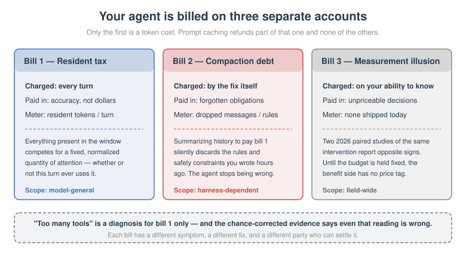
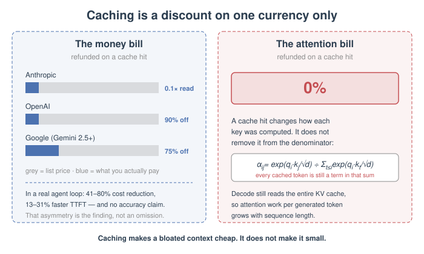
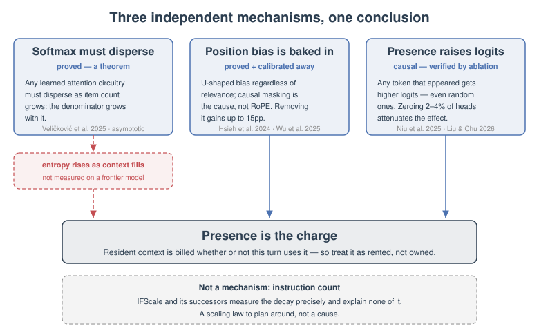
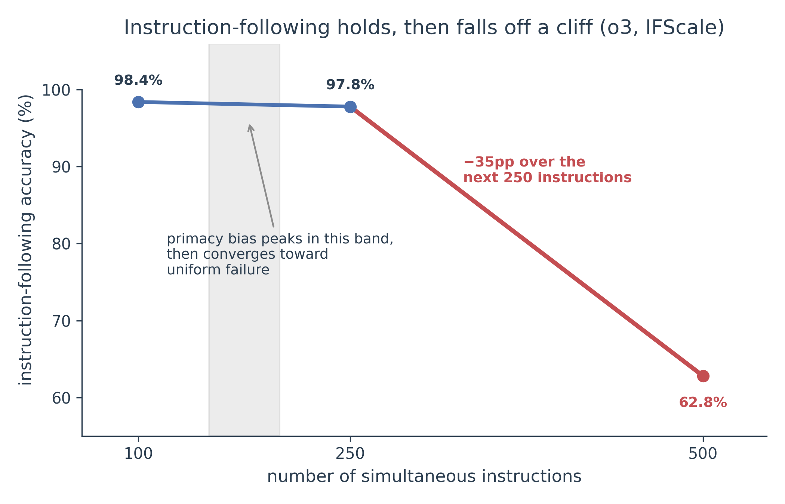
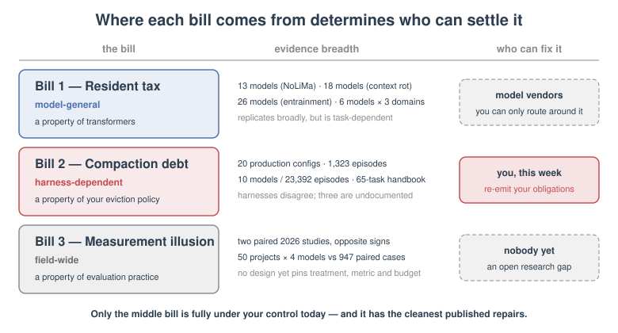
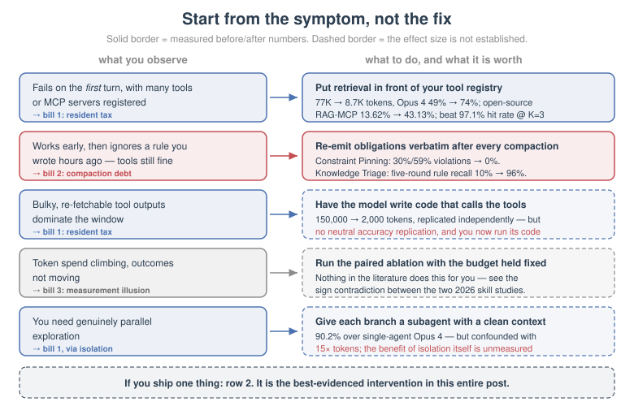

Anthropic published a number that should have ended the argument: connecting an agent to a few MCP servers put **150,000 tokens** of tool definitions in front of the model before it read a single line of the task. Rewriting those tools as code the model could call brought that to **2,000 tokens** — a **98.7%** saving ([code execution with MCP](https://www.anthropic.com/engineering/code-execution-with-mcp)).

Everyone drew the obvious conclusion. Too many tools. Trim the tool list.

Then a chance-corrected study measured exactly that. On [BFCL](https://gorilla.cs.berkeley.edu/leaderboard.html) with **370 tools** available, a retrieval agent that showed the model **7 tools on average** scored **90.3%**. An agent that showed it a fixed **50** scored **90.8%** ([Repantis et al. 2026](https://arxiv.org/abs/2605.24660)). Seven times less depth, and the difference is noise.

So we have two 2026 measurements that look like they are on the same axis and disagree completely. Removing ~148,000 tokens of tool definitions raises Opus 4's tool-use accuracy from **49% to 74%** ([advanced tool use](https://www.anthropic.com/engineering/advanced-tool-use)). Removing 43 of 50 visible tools changes nothing. Both are real. Both are careful.

And there is a third thing that should make you suspicious of the whole framing: **prompt caching**. If a 150K-token tool preamble is cached and re-read at **0.1×** price ([Anthropic prompt caching](https://platform.claude.com/docs/en/build-with-claude/prompt-caching)), why is anyone still talking about it as a cost?

<figure>
<a href="figures/figure_three_bills.svg" target="_blank" rel="noopener" title="Open full-size figure" style="display:block;box-shadow:none;text-decoration:none;border:0">

</a>
<figcaption>Figure 1: Agent degradation is not one variable. It is three accounts that are billed separately, in different currencies, and settled by different fixes.</figcaption>
</figure>

My claim in this post is that all three observations are consistent, and that the reason they look contradictory is an accounting error. "Context bloat" is not one bill. It is three, they are denominated in different currencies, and each one is settled by a different fix:

1. A **resident attention tax**, charged on every turn for everything that is present.
2. A **compaction debt**, incurred by the standard fix for bill 1.
3. A **measurement illusion**, which prevents you from knowing whether the capability package you installed was worth either of the first two.

Most teams I talk to are paying all three and reading only the invoice for dollars — the one bill that gets refunded.

## Reading the Invoice in the Right Currency

Prompt caching refunds roughly 90% of the money and **none** of the attention. Caching is a prefill-recomputation optimization: the engine stores the key/value tensors for a prefix and skips recomputing them. It does not remove those tokens from the model's view. Every token the model subsequently generates still attends over all of them, in full.

That is worth being precise about, because it is the load-bearing step in the whole argument. For a query at position $i$, the attention weight on a resident token $j$ is

$$
\alpha_{ij} = \frac{\exp\!\left(q_i \cdot k_j / \sqrt{d}\right)}{\sum_{t \le i} \exp\!\left(q_i \cdot k_t / \sqrt{d}\right)}
$$

Cache hits change how $k_j$ got computed. They do not change the sum in the denominator. Every cached tool-definition token is still a term in it, for every generated token. [Modular's inference handbook](https://handbook.modular.com/inference-optimization/prefix-caching/) states the operational consequence plainly — decode "still reads the entire KV cache so attention per generated token grows with sequence length," and prefix caching "does not change model output." The [vLLM automatic prefix caching design](https://docs.vllm.ai/en/latest/design/prefix_caching/) describes the same reuse-of-K/V-only semantics, and [PagedAttention](https://arxiv.org/abs/2309.06180) is the mechanism that makes that sharing cheap. The per-token arithmetic is standard ([Pope et al. 2022](https://arxiv.org/abs/2211.05102)).

So the money side of the ledger:

- Anthropic: cache write **1.25×** (5-minute TTL) or **2×** (1-hour), cache read **0.1×**, invalidated by any change to tool definitions or the system prompt ([Anthropic prompt caching](https://platform.claude.com/docs/en/build-with-claude/prompt-caching)).
- OpenAI: **90% off** cached input, 1,024-token minimum, roughly 30-minute eviction, invalidated by any prefix change ([OpenAI prompt caching](https://developers.openai.com/api/docs/guides/prompt-caching)).
- Google: implicit caching on Gemini 2.5+, **75%** discount ([Google Developers Blog](https://developers.googleblog.com/gemini-2-5-models-now-support-implicit-caching/)).

And in an actual agent loop, [Lumer et al. 2026](https://arxiv.org/abs/2601.06007) measured **41–80% cost reduction** and **13–31% TTFT improvement** from cache-aware prompt construction on DeepResearch Bench. Notice what that paper does not claim: any effect on accuracy. That asymmetry is not an omission. It is the finding.

I want to be careful not to overclaim the next step. The KV arithmetic establishes that cached tokens are fully attended. It does **not** by itself prove that being fully attended degrades behavior. That degradation is a separate empirical result, and it has a name from the vendor who ships the most agent-hours: Anthropic describes LLMs as having an **attention budget** that "every new token introduced depletes," producing **context rot** — "as the number of tokens in the context window increases, the model's ability to accurately recall information from that context decreases" ([effective context engineering](https://www.anthropic.com/engineering/effective-context-engineering-for-ai-agents)). [Hong et al. 2025](https://research.trychroma.com/context-rot) measured it across **18 LLMs** and found performance is nonuniform in input length rather than smoothly decaying.

<figure>
<a href="figures/figure_caching_refund.svg" target="_blank" rel="noopener" title="Open full-size figure" style="display:block;box-shadow:none;text-decoration:none;border:0">

</a>
<figcaption>Figure 2: Caching is a discount on one currency only. Cost figures from <a href="https://platform.claude.com/docs/en/build-with-claude/prompt-caching">Anthropic</a>, <a href="https://developers.openai.com/api/docs/guides/prompt-caching">OpenAI</a> and <a href="https://developers.googleblog.com/gemini-2-5-models-now-support-implicit-caching/">Google</a>; the zero-refund side follows from the attention arithmetic in <a href="https://arxiv.org/abs/2211.05102">Pope et al. 2022</a>.</figcaption>
</figure>

This also dissolves the tool-count paradox, and it is worth naming the resolution before we go further, because it is the single most common reasoning error I see in this discussion. The two studies estimate **different quantities**. [Repantis et al. 2026](https://arxiv.org/abs/2605.24660) measure *selection accuracy given that retrieval already happened* — chance-corrected, so the credit for a smaller candidate set is removed. Anthropic measures *end-to-end task success with definitions resident in context*. "Does the model pick the right tool out of 50?" and "does the agent finish the job while 77K tokens of schema sit in its context?" are not the same question, and nothing forces them to have the same answer.

With that instrument in hand — bill it in accuracy and attention budget, not dollars — the published record separates cleanly into three accounts.

## Three Bills, Not One

The evidence sorts into a per-turn tax on resident content, a debt created by compacting that content away, and a field-wide failure to measure whether the content earned its keep. This section is deliberately descriptive: what the numbers say, not yet why. The mechanism comes after.

### The resident tax, charged every turn

Content that is present costs accuracy even when it is never used. The cleanest demonstration is [Song et al. 2025](https://arxiv.org/abs/2508.12566), who attached **30 MCP tool suites** to six LLMs across three task domains and measured a **9.5% average performance decline** while input-token volume grew by **3.25× to 236.5×**. More capability, less capability.

The repair numbers are larger than the damage numbers, which is the tell. Anthropic reports **~72K tokens** of tool definitions inside **~77K tokens** of total context "before any work begins"; routing tool discovery through a search tool brings that to **~8.7K — an 85% reduction** — and accuracy goes *up*: Opus 4 from **49% to 74%**, Opus 4.5 from **79.5% to 88.1%** ([advanced tool use](https://www.anthropic.com/engineering/advanced-tool-use)). The open-source version of the same idea, [Gan & Sun 2025](https://arxiv.org/abs/2505.03275), puts a retriever in front of an MCP registry of 4,400+ servers and moves accuracy from **13.62% to 43.13%** while cutting prompt tokens by more than half. [Sadani & Kumar 2026](https://arxiv.org/abs/2604.21816) report per-turn tool tokens dropping **47.3k → 2.4k (95.0%)** — though on a *simulated* 120-tool benchmark, with the downstream success and latency figures explicitly labelled projections, so I quote only the token number.

None of this is specific to tools. It is a property of long context in general. [Modarressi et al. 2025](https://arxiv.org/abs/2502.05167) built NoLiMa to strip literal-match shortcuts out of long-context retrieval and found that at **32K tokens, 11 of 13 models drop below 50% of their strong short-length baselines**. And the tax is charged on your safety machinery too: [Martin & Roger 2026](https://arxiv.org/abs/2605.12366) found that monitor models watching an agent's trajectory miss the actions they are supposed to catch **2× to 30× more often** when those actions occur after 800K tokens of benign activity, on Opus 4.6, GPT 5.4 and Gemini 3.1.

<figure>
<a href="figures/figure_resident_tax.svg?v=4" target="_blank" rel="noopener" title="Open full-size figure" style="display:block;box-shadow:none;text-decoration:none;border:0">
<picture>
<source media="(max-width: 520px)" srcset="figures/figure_resident_tax_mobile.svg?v=4">

</picture>
</a>
<figcaption>Figure 3: Removing resident tool definitions raises accuracy (<a href="https://www.anthropic.com/engineering/advanced-tool-use">Anthropic</a>, <a href="https://arxiv.org/abs/2505.03275">Gan &amp; Sun 2025</a>), while changing how many tools are <em>visible</em> at fixed retrieval quality does not (<a href="https://arxiv.org/abs/2605.24660">Repantis et al. 2026</a>). The bottom pair is the null result that makes the first three interesting.</figcaption>
</figure>

One caveat that stops this from being a tidy dilution story: in [Hong et al. 2025](https://research.trychroma.com/context-rot), *shuffled* haystacks sometimes outperformed logically structured ones. Whatever is going on is not simply "more text, thinner attention."

### The compaction debt, charged by the fix

The standard remedy for a full context window is to summarize and drop, and that remedy silently deletes the rules you care about most. [Zerhoudi et al. 2026](https://arxiv.org/abs/2608.22752) ran Claude Code's `/compact` against 20 production agent configurations on Sonnet 4.6 and found it **preserves 53% of safety rules after one compaction round and 10% after five**. [Chen 2026](https://arxiv.org/abs/2606.22528) measured the behavioral consequence across **1,323 episodes**: constraint violation rises from **0% with full context to 30% after compaction, reaching 59% for some models**.

Read those two together. The first says the rules leave the context. The second says the agent then breaks them. That is not a summarization-quality problem you can prompt your way out of; it is a structural property of dropping tokens that encode obligations rather than facts.

The downstream picture matches. [Panavas et al. 2026](https://arxiv.org/abs/2607.25398) built HANDBOOK.md — 65 tasks, 824 grading criteria — for long-context agentic instruction following, and report that the **strongest evaluated model passes 36.2% of trials**, with agents losing rule details over long horizons. [Khanal et al. 2026](https://arxiv.org/abs/2603.29231) went further and stratified reliability by domain across 10 models and 23,392 episodes: software-engineering goal-directed success **drops from 0.90 to 0.44** as horizons lengthen.

And the harnesses do not agree on any of this. A [survey of harness compaction behaviour](https://gist.github.com/badlogic/cd2ef65b0697c4dbe2d13fbecb0a0a5f) found Claude Code triggers at ~95% capacity and summarizes away old messages; Codex CLI keeps a summary plus the last 20k tokens of user messages; OpenCode prunes tool outputs beyond a 40k protected window; Cline, Cursor and Gemini CLI are undocumented. If you have not read your harness's compaction policy, you do not know what your agent forgets.

<figure>
<a href="figures/figure_compaction_debt.svg?v=6" target="_blank" rel="noopener" title="Open full-size figure" style="display:block;box-shadow:none;text-decoration:none;border:0">
<picture>
<source media="(max-width: 520px)" srcset="figures/figure_compaction_debt_mobile.svg?v=6">

</picture>
</a>
<figcaption>Figure 4: The compaction debt and its two published repairs. Retention data from <a href="https://arxiv.org/abs/2608.22752">Zerhoudi et al. 2026</a>; violation data from <a href="https://arxiv.org/abs/2606.22528">Chen 2026</a>. These are the only mitigations in this post with clean before/after numbers on the same benchmark.</figcaption>
</figure>

### The measurement illusion, charged on your ability to know

Two 2026 papers measured whether Agent Skills help, using paired designs, and got opposite signs. [Yang & Ding 2026](https://arxiv.org/abs/2608.23067) injected 31 public skills into 50 Web-Bench projects across four models and report that target-skill injection **reduces mean Pass@2 by 1.3% to 4.2%** while **increasing token cost by 72% to 394%**, with gains in only **17% to 36%** of skill-project pairs. [Kevin et al. 2026](https://arxiv.org/abs/2608.20614) evaluated skills as first-class objects over **947 scored paired cases** and report mean composite Skill Lift of **+0.2134**, 95% CI **[0.1967, 0.2301]**, with an outcome-only lift of **+0.1799**.

One paper says installing a skill costs you accuracy and triples your tokens. The other says it lifts a composite score by more than 0.2 with a confidence interval nowhere near zero. Same construct, same year, both paired, opposite sign.

I do not think either team is careless. I think the construct is underspecified, and three specific things are free to vary between the two designs: **what counts as the treatment** (a skill that overlaps the model's prior knowledge is not the same intervention as one that does not), **what the metric rewards** (a process-shaped metric can credit the mere presence of the treatment), and **whether the token budget is held fixed** (a package that adds 394% more tokens is also buying more compute). Until a study pins all three down, "does adding a skill help?" is not a question the literature has answered — it is a question the literature has answered twice, in both directions.

That is the third bill. You are paying a resident tax and a compaction debt for capability packages whose benefit is, right now, **not correctly measured**.

<figure>
<a href="figures/figure_opposite_sign.svg?v=2" target="_blank" rel="noopener" title="Open full-size figure" style="display:block;box-shadow:none;text-decoration:none;border:0">
<picture>
<source media="(max-width: 520px)" srcset="figures/figure_opposite_sign_mobile.svg?v=2">

</picture>
</a>
<figcaption>Figure 5: The sign contradiction at the centre of skill evaluation. Left: <a href="https://arxiv.org/abs/2608.23067">Yang &amp; Ding 2026</a>. Right: <a href="https://arxiv.org/abs/2608.20614">Kevin et al. 2026</a>. Three degrees of freedom — treatment definition, metric shape, and budget control — are unpinned in both.</figcaption>
</figure>

Three bills, then. The next question is why the first one exists at all, because if presence is free, none of this should happen.

## Presence Is the Charge

Resident content costs you accuracy because attention is a normalized, finite quantity and every present token claims a share of it — and because some tokens claim more than their share purely by having appeared. Three mechanisms are established well enough to name. One popular explanation is not, and I will flag it.

**Softmax has to disperse.** [Veličković et al. 2025](https://arxiv.org/abs/2410.01104) prove that for tasks as simple as finding the maximum key, **any learned attention circuitry must disperse as the number of items grows at test time**. This is a theorem, not a hypothesis: a softmax cannot hold a sharp lookup as $n$ grows, because the denominator grows with it. The caveat is real — the result is asymptotic and stated for max-retrieval, not for instruction-following on a frontier model.

The bridge from dispersion to behavior is partly causal. [Zhang et al. 2025](https://arxiv.org/abs/2412.16545) identify unusually high attention entropy as the key factor in a long-context failure mode, then *reduce* entropy with attention sinks and recover the performance gap — an intervention, not a correlation. A supporting result, [attention head entropy predicting answer correctness](https://arxiv.org/abs/2602.13699), gets +8.5% AUROC from per-head entropy and +17.7% using attention over the question before generation, but that one is correlational.

Here I have to state a gap rather than paper over it: **I could not find a published entropy-versus-context-length curve for a frontier model.** The step "entropy rises as context fills" is theoretically forced and consistent with everything above, but as far as I can tell nobody has measured it at scale on a model you would actually deploy. Treat it as a strong inference, not a measurement.

**Position bias is baked in, and RoPE is not the culprit.** [Hsieh et al. 2024](https://arxiv.org/abs/2406.16008) show that LLMs exhibit a **U-shaped attention bias where tokens at the beginning and end receive higher attention regardless of their relevance**, and that calibrating it away gains **up to 15 percentage points** — the attention-level mechanism under the familiar lost-in-the-middle behavior first characterized by [Liu et al. 2023](https://arxiv.org/abs/2307.03172). [Wu et al. 2025](https://arxiv.org/abs/2502.01951) supply a graph-theoretic proof that **causal masking inherently biases attention toward earlier positions**, because deeper layers attend to increasingly contextualized early-token representations; RoPE's distance decay *competes* with that bias rather than causing it. A preprint, [Chowdhury 2026](https://arxiv.org/abs/2603.10123), goes further and claims the U-shape is present at initialization, identical with or without RoPE — unrefereed, so hold it loosely, but it points the same way. If you have been blaming positional encodings for the sagging middle of your context, the evidence does not support you.

**And presence alone raises token probability.** This is the mechanism that most directly justifies calling it rent. [Niu et al. 2025](https://arxiv.org/abs/2505.09338) show that language models assign significantly higher logits to **any** token that has previously appeared in the context — **even random tokens** — then locate the responsible "entrainment heads" by differentiable masking and demonstrate that **zeroing them attenuates the effect**. That is a causal claim with an intervention behind it. A 26-model follow-up, [Liu & Chu 2026](https://arxiv.org/abs/2606.24077), finds the effect is controlled by just **2–4% of attention heads**.

There is a tension in that result worth stating, because it complicates the simple story: entrainment is relevance-independent (mere residence raises probability) but also semantically modulated (similar content interferes more). So "related tools confuse the model more" is a modulation on top of the base mechanism, not the mechanism itself. The base mechanism is presence.

The distractor literature lands in the same place from the retrieval side. [Cuconasu et al. 2024](https://arxiv.org/abs/2401.14887) found that a retriever's **highest-scoring documents that are not directly relevant** hurt effectiveness the most, while adding random documents *helped* — the direction is robust, though the headline magnitude has been hard to reproduce, so I would not lean on the specific figure. [Amiraz et al. 2025](https://arxiv.org/abs/2505.06914) formalize a quantifiable distracting effect — and, usefully, show the direction is exploitable: fine-tuning on deliberately hard distracting passages gains **up to 7.5%** answering accuracy over conventional RAG fine-tuning.

<figure>
<a href="figures/figure_mechanisms.svg" target="_blank" rel="noopener" title="Open full-size figure" style="display:block;box-shadow:none;text-decoration:none;border:0">

</a>
<figcaption>Figure 6: Three independent mechanisms, one conclusion. Dispersion is a theorem (<a href="https://arxiv.org/abs/2410.01104">Veličković et al. 2025</a>), position bias follows from causal masking (<a href="https://arxiv.org/abs/2502.01951">Wu et al. 2025</a>), and entrainment is localized to 2–4% of heads and verified by ablation (<a href="https://arxiv.org/abs/2505.09338">Niu et al. 2025</a>, <a href="https://arxiv.org/abs/2606.24077">Liu &amp; Chu 2026</a>). The dashed arrow is the step I could not find measured on a frontier model.</figcaption>
</figure>

One thing that is emphatically **not** a mechanism, despite being the most quotable result in this area: instruction interference. [Jaroslawicz et al. 2025](https://arxiv.org/abs/2507.11538) built IFScale and found o3 goes **98.4%** at 100 instructions, **97.8%** at 250, and **62.8%** at 500, with primacy bias peaking around 150–200 instructions before "converging toward uniform failure." [Harada et al. 2025](https://arxiv.org/abs/2509.21051) show that logistic regression on **instruction count alone** predicts compliance within about 10% error. These are excellent measurements and they explain nothing — neither paper connects instruction count to attention or to representations. Cite them as a scaling law you must plan around, not as an explanation.

<figure>
<a href="figures/figure_instruction_scaling.png" target="_blank" rel="noopener" title="Open full-size figure" style="display:block;box-shadow:none;text-decoration:none;border:0">

</a>
<figcaption>Figure 7: Instruction-following does not decay gently; it holds and then falls off. Data from <a href="https://arxiv.org/abs/2507.11538">Jaroslawicz et al. 2025</a>. Every rule in your CLAUDE.md, every skill you install, and every constraint you pin is competing on this axis.</figcaption>
</figure>

Mechanisms in hand, the honest next question is how far the claim actually generalizes — because at least one careful result says it does not.

## How Universal Is This?

The resident tax replicates broadly across model families but depends on the task; the compaction debt depends on your harness, not your model; the measurement illusion is field-wide. Those three scopes are not interchangeable, and mistaking one for another is how teams end up fixing the wrong thing.

The evidence base is wide enough to take seriously: 13 models in [Modarressi et al. 2025](https://arxiv.org/abs/2502.05167), 18 in [Hong et al. 2025](https://research.trychroma.com/context-rot), 26 in [Liu & Chu 2026](https://arxiv.org/abs/2606.24077), six across three domains in [Song et al. 2025](https://arxiv.org/abs/2508.12566), 10 models and 23,392 episodes in [Khanal et al. 2026](https://arxiv.org/abs/2603.29231), and three frontier models in [Martin & Roger 2026](https://arxiv.org/abs/2605.12366).

But two results genuinely bound the claim, and a post that skipped them would be selling you something.

The first is the null result we opened with. [Repantis et al. 2026](https://arxiv.org/abs/2605.24660) is the strongest available counter-evidence to naive monotonic decay: once you chance-correct, visible tool count buys nothing on BFCL. If you were planning to spend a quarter shrinking your tool list to improve selection accuracy, this paper says don't.

The second is more interesting. [Semenov & Dorofeev 2026](https://arxiv.org/abs/2606.11213) report a single agent session completing **89 sequential tasks across 80 million tokens with no measurable degradation** in task accuracy relative to per-task isolated sessions, using structured context eviction instead of compaction. That is an extraordinary claim and I want to be precise about its weight: it is **one session, one model, on one harness fork** — a case study, not a multi-seed controlled benchmark, and the authors are explicit about the annotation burden it requires. It is the best existing evidence that the compaction debt is optional rather than inherent, and it is nowhere near strong enough to plan on.

So the scope is: bill 1 is a property of transformers, bill 2 is a property of your harness's eviction policy, and bill 3 is a property of the field's current evaluation practice. Only the middle one is fully under your control today.

<figure>
<a href="figures/figure_scope.svg" target="_blank" rel="noopener" title="Open full-size figure" style="display:block;box-shadow:none;text-decoration:none;border:0">

</a>
<figcaption>Figure 8: Where each bill comes from determines who can fix it. The compaction debt is the one you can settle this week.</figcaption>
</figure>

Which brings us to the part you can act on, and to the one gap in this literature that I think is a genuine opportunity.

## Pay the Bill That Matches Your Failure

There is no published decision procedure that keys a context mitigation to an observed failure mode. The closest thing is Anthropic's cookbook guidance — compaction for long dialogue, tool-result clearing for bulky re-fetchable outputs, a memory tool for cross-session state — which is three coarse heuristics with no thresholds and no effect sizes.

So here is the procedure I use. It is a contribution rather than a citation, and I have marked which branches rest on measured before/after numbers and which do not.

Start from the symptom, not the fix:

1. **The agent fails on the *first* turn of a session, with many tools or servers registered.** You are paying the resident tax. Put retrieval in front of your tool registry. Measured: Anthropic's Tool Search Tool takes ~77K → ~8.7K with Opus 4 at **49% → 74%** ([advanced tool use](https://www.anthropic.com/engineering/advanced-tool-use)); [Gan & Sun 2025](https://arxiv.org/abs/2505.03275) get **13.62% → 43.13%**; [Mudunuri et al. 2026](https://arxiv.org/abs/2603.20313) report a **97.1% hit rate at K=3** over 121 tools from five MCP servers, which is the number to beat before you trust a retriever in this position.

2. **The agent works early and then ignores a rule you wrote hours ago, while still calling tools correctly.** That is the compaction debt, not the resident tax, and the fix is different: re-emit obligations after every compaction. Measured: Constraint Pinning returns post-compaction violations from 30%/59% back to **0%** ([Chen 2026](https://arxiv.org/abs/2606.22528)), and Knowledge Triage restores five-round rule recall from **10% to 96%** ([Zerhoudi et al. 2026](https://arxiv.org/abs/2608.22752)). These are the two best-evidenced interventions in this entire post. If you do one thing after reading it, do this one.

3. **Bulky, re-fetchable tool outputs dominate your context.** Stop passing them through the model. Have the model write code that calls the tools instead: **150,000 → 2,000 tokens** ([code execution with MCP](https://www.anthropic.com/engineering/code-execution-with-mcp)), a pattern independently implemented by [Cloudflare's Code Mode](https://blog.cloudflare.com/code-mode-mcp/), which exposes an entire API in roughly 1,000 tokens. Caveat with teeth: the *token* savings are replicated, the *accuracy* is not — I found no neutral third-party accuracy replication — and you are now running model-authored code, which is why Code Mode sandboxes it with outbound fetch disabled by default.

4. **Token spend is climbing and outcomes are not moving.** You are in the measurement illusion. Before you install another skill, run the paired ablation with the token budget held fixed — otherwise you cannot distinguish "the skill taught it something" from "the skill bought it more compute." Nothing in the literature will do this for you; see the sign contradiction in [Yang & Ding 2026](https://arxiv.org/abs/2608.23067) versus [Kevin et al. 2026](https://arxiv.org/abs/2608.20614).

5. **You need genuinely parallel exploration.** Subagents give each branch a clean context, and Anthropic reports **90.2%** improvement over single-agent Opus 4 on its internal research eval — but be honest about what that number is: it confounds context isolation, parallelism, and **15× more tokens**, and on BrowseComp "token usage by itself explains 80% of the variance" ([multi-agent research system](https://www.anthropic.com/engineering/multi-agent-research-system)). The benefit of isolation *per se* is unmeasured. Use subagents for parallelism, and do not claim the isolation as your win.

<figure>
<a href="figures/figure_decision_tree.svg" target="_blank" rel="noopener" title="Open full-size figure" style="display:block;box-shadow:none;text-decoration:none;border:0">

</a>
<figcaption>Figure 9: The decision procedure, with the evidence quality marked. Solid borders are interventions with published before/after numbers on the same benchmark (<a href="https://www.anthropic.com/engineering/advanced-tool-use">Anthropic</a>, <a href="https://arxiv.org/abs/2505.03275">Gan &amp; Sun 2025</a>, <a href="https://arxiv.org/abs/2606.22528">Chen 2026</a>, <a href="https://arxiv.org/abs/2608.22752">Zerhoudi et al. 2026</a>); dashed borders are interventions whose token savings are established but whose accuracy effect is not.</figcaption>
</figure>

The minimal viable stack, if you ship nothing else: a retrieval-backed tool registry instead of a static tool array; a pinned constraint block re-emitted after every compaction; and a fixed-budget paired eval gating every new capability package. In code, the first two live in one function:

```python
def assemble_turn(task, registry, pinned_rules, history, budget):
    # 1. resident tax: retrieve tools, never enumerate them
    tools = registry.search(task.query, k=budget.max_tools)   # not registry.all()

    # 2. compaction debt: obligations are re-emitted, never summarized
    blocks = [pinned_rules]                                   # always first, always verbatim

    # 3. fill the remaining window newest-first, and record what was dropped
    spent, dropped = 0, []
    for msg in reversed(history):
        cost = count_tokens(msg)
        if spent + cost > budget.history_tokens:
            dropped.append(msg.id)
            continue
        blocks.append(msg)
        spent += cost

    emit_metric("resident_tokens", count_tokens(pinned_rules) + tool_tokens(tools) + spent)
    emit_metric("dropped_messages", len(dropped))
    return Prompt(system=blocks[0], tools=tools, messages=list(reversed(blocks[1:])))
```

The two `emit_metric` calls are the point. Per-turn resident tokens and dropped-message count are the only two numbers that let you tell bill 1 from bill 2 in production, and almost no harness reports either.

## Looking Ahead

My honest read is that the field has priced the wrong side of the ledger, and for an understandable reason: cost is easy to measure, easy to attribute, and 90% refundable, so that is what gets published. Attention budget is none of those things. Every vendor blog post in my reference list leads with a token reduction and treats the accuracy change as a bonus — including the ones whose accuracy numbers are the most interesting thing in them.

Three measurements would settle most of what this post had to hedge, and I think they are all tractable:

**An entropy-versus-length curve on a frontier model.** The dispersion theorem is proved and the entropy intervention works in a restricted setting, but the connecting measurement is missing. Someone with API access to attention weights, or a strong open-weights proxy, could produce it in a week.

**An isolation-only ablation for subagents.** Hold token budget and parallelism fixed, vary only whether the sub-task gets a clean context. Anthropic's 90.2% cannot be decomposed without it, and the entire "just use subagents" consensus rests on that undecomposed number.

**A budget-controlled paired skill evaluation.** The sign contradiction between [Yang & Ding 2026](https://arxiv.org/abs/2608.23067) and [Kevin et al. 2026](https://arxiv.org/abs/2608.20614) will not resolve by adding more benchmarks; it needs a design that pins down the treatment, refuses process metrics that reward the treatment's mere presence, and equalizes tokens across arms. This is the one I am working on, and the reason I care: right now, every team installing capability packages into a coding agent is making a purchasing decision with no price tag on the benefit side.

Until then, the practical stance I would defend: treat everything resident in your context as rented, not owned. Charge it a monthly fee. Make it re-justify the space. And when you compact, remember that you are not compressing history — you are choosing which of your obligations to forget.

## Citation

Cited as:

> Gao, Xueping. "The Context Bill". hellogxp.github.io (September 2026). https://hellogxp.github.io/posts/the-context-bill/

Or use the BibTeX citation:

```bibtex
@article{xueping2026contextbill,
  title = {The Context Bill},
  author = {Gao, Xueping},
  journal = {hellogxp.github.io},
  year = {2026},
  month = {September},
  url = "https://hellogxp.github.io/posts/the-context-bill/"
}
```

## References

[1] Repantis, V., Gawde, A., Singh, H., & Blackwell, J. ["How Many Tools Should an LLM Agent See? A Chance-Corrected Answer."](https://arxiv.org/abs/2605.24660) arXiv:2605.24660 (2026).

[2] Gorilla LLM Team, UC Berkeley. ["Berkeley Function-Calling Leaderboard."](https://gorilla.cs.berkeley.edu/leaderboard.html) Accessed September 2026.

[3] Song, W., Zhong, H., Ding, Z., Xue, J., & Li, Y. ["Help or Hurdle? Rethinking Model Context Protocol-Augmented Large Language Models."](https://arxiv.org/abs/2508.12566) arXiv:2508.12566 (2025).

[4] Gan, T. & Sun, Q. ["RAG-MCP: Mitigating Prompt Bloat in LLM Tool Selection via Retrieval-Augmented Generation."](https://arxiv.org/abs/2505.03275) arXiv:2505.03275 (2025).

[5] Sadani, A. & Kumar, D. ["Tool Attention Is All You Need: Dynamic Tool Gating and Lazy Schema Loading for Eliminating the MCP/Tools Tax in Scalable Agentic Workflows."](https://arxiv.org/abs/2604.21816) arXiv:2604.21816 (2026).

[6] Mudunuri, S., Wan, J., Qin, A., & Manoharan, S. ["Semantic Tool Discovery for Large Language Models: A Vector-Based Approach to MCP Tool Selection."](https://arxiv.org/abs/2603.20313) arXiv:2603.20313 (2026).

[7] Modarressi, A., Deilamsalehy, H., Dernoncourt, F., Bui, T., Rossi, R. A., Yoon, S., & Schütze, H. ["NoLiMa: Long-Context Evaluation Beyond Literal Matching."](https://arxiv.org/abs/2502.05167) ICML 2025.

[8] Martin, S. & Roger, F. ["Classifier Context Rot: Monitor Performance Degrades with Context Length."](https://arxiv.org/abs/2605.12366) arXiv:2605.12366 (2026).

[9] Hong, K., Troynikov, A., & Huber, J. ["Context Rot: How Increasing Input Tokens Impacts LLM Performance."](https://research.trychroma.com/context-rot) Chroma Technical Report (2025).

[10] Zerhoudi, S., Mitrovic, J., & Granitzer, M. ["The Compaction Cliff in Long-Running AI Agent Memory."](https://arxiv.org/abs/2608.22752) CIKM 2026.

[11] Chen, S. ["Governance Decay: How Context Compaction Silently Erases Safety Constraints in Long-Horizon LLM Agents."](https://arxiv.org/abs/2606.22528) arXiv:2606.22528 (2026).

[12] Panavas, L., Minus, S., Monton, B., Ray, D., Garre, S., Mehta, S., & Chen, E. ["HANDBOOK.md: A Benchmark for Long-Context Agentic Instruction Following."](https://arxiv.org/abs/2607.25398) Workshop on Agent Behavior (WAB) @ COLM 2026.

[13] Khanal, A., Tao, Y., & Zhou, J. ["Beyond pass@1: A Reliability Science Framework for Long-Horizon LLM Agents."](https://arxiv.org/abs/2603.29231) arXiv:2603.29231 (2026).

[14] badlogic. ["compaction.md."](https://gist.github.com/badlogic/cd2ef65b0697c4dbe2d13fbecb0a0a5f) GitHub Gist (December 2025).

[15] Semenov, A. & Dorofeev, S. ["Beyond Compaction: Structured Context Eviction for Long-Horizon Agents."](https://arxiv.org/abs/2606.11213) arXiv:2606.11213 (2026).

[16] Yang, Z. & Ding, F. ["Signal or Noise? A Benchmark Study of Agent Skills in Web Development."](https://arxiv.org/abs/2608.23067) arXiv:2608.23067 (2026).

[17] Kevin, C., Raghavan, N., Puget, J.-F., Malani, R., Puvvadi, M., Abramovitch, M., Gupta, M., Akkiraju, R., Prabhu, S., Dangi, Y., Luo, W., & Lee, S. H. ["Evaluating Skills, Not Just Agents: Agentic Continuous Evaluation of Skills."](https://arxiv.org/abs/2608.20614) arXiv:2608.20614 (2026).

[18] Veličković, P., Perivolaropoulos, C., Barbero, F., & Pascanu, R. ["Softmax is not Enough (for Sharp Size Generalisation)."](https://arxiv.org/abs/2410.01104) ICML 2025.

[19] Zhang, Z., Wang, Y., Huang, X., Fang, T., Zhang, H., Deng, C., Li, S., & Yu, D. ["Attention Entropy is a Key Factor: An Analysis of Parallel Context Encoding with Full-attention-based Pre-trained Language Models."](https://arxiv.org/abs/2412.16545) ACL 2025.

[20] Ostmeier, S., Axelrod, B., Varma, M., Aali, A., Zhang, Y., Paschali, M., Koyejo, S., Langlotz, C., & Chaudhari, A. ["Attention Head Entropy of LLMs Predicts Answer Correctness."](https://arxiv.org/abs/2602.13699) arXiv:2602.13699 (2026).

[21] Hsieh, C.-Y., Chuang, Y.-S., Li, C.-L., Wang, Z., Le, L. T., Kumar, A., Glass, J., Ratner, A., Lee, C.-Y., Krishna, R., & Pfister, T. ["Found in the Middle: Calibrating Positional Attention Bias Improves Long Context Utilization."](https://arxiv.org/abs/2406.16008) ACL Findings 2024.

[22] Liu, N. F., Lin, K., Hewitt, J., Paranjape, A., Bevilacqua, M., Petroni, F., & Liang, P. ["Lost in the Middle: How Language Models Use Long Contexts."](https://arxiv.org/abs/2307.03172) TACL 2024.

[23] Wu, X., Wang, Y., Jegelka, S., & Jadbabaie, A. ["On the Emergence of Position Bias in Transformers."](https://arxiv.org/abs/2502.01951) ICML 2025.

[24] Chowdhury, B. D. ["Lost in the Middle at Birth: An Exact Theory of Transformer Position Bias."](https://arxiv.org/abs/2603.10123) arXiv:2603.10123 (2026).

[25] Niu, J., Yuan, X., Wang, T., Saghir, H., & Abdi, A. H. ["Llama See, Llama Do: A Mechanistic Perspective on Contextual Entrainment and Distraction in LLMs."](https://arxiv.org/abs/2505.09338) ACL 2025.

[26] Liu, Y. & Chu, C. ["Sentence-Level Contextual Entrainment in Large Language Models."](https://arxiv.org/abs/2606.24077) arXiv:2606.24077 (2026).

[27] Cuconasu, F., Trappolini, G., Siciliano, F., Filice, S., Campagnano, C., Maarek, Y., Tonellotto, N., & Silvestri, F. ["The Power of Noise: Redefining Retrieval for RAG Systems."](https://arxiv.org/abs/2401.14887) SIGIR 2024.

[28] Amiraz, C., Cuconasu, F., Filice, S., & Karnin, Z. ["The Distracting Effect: Understanding Irrelevant Passages in RAG."](https://arxiv.org/abs/2505.06914) arXiv:2505.06914 (2025).

[29] Jaroslawicz, D., Whiting, B., Shah, P., & Maamari, K. ["How Many Instructions Can LLMs Follow at Once?"](https://arxiv.org/abs/2507.11538) arXiv:2507.11538 (2025).

[30] Harada, K., Yamazaki, Y., Taniguchi, M., Marrese-Taylor, E., Kojima, T., Iwasawa, Y., & Matsuo, Y. ["When Instructions Multiply: Measuring and Estimating LLM Capabilities of Multiple Instructions Following."](https://arxiv.org/abs/2509.21051) EMNLP 2025.

[31] Lumer, E., Nizar, F., Jangiti, A., Frank, K., Gulati, A., Phadate, M., & Subbiah, V. K. ["Don't Break the Cache: An Evaluation of Prompt Caching for Long-Horizon Agentic Tasks."](https://arxiv.org/abs/2601.06007) arXiv:2601.06007 (2026).

[32] Anthropic. ["Prompt caching."](https://platform.claude.com/docs/en/build-with-claude/prompt-caching) Claude API documentation, accessed September 2026.

[33] OpenAI. ["Prompt caching."](https://developers.openai.com/api/docs/guides/prompt-caching) OpenAI API documentation, accessed September 2026.

[34] Google. ["Gemini 2.5 models now support implicit caching."](https://developers.googleblog.com/gemini-2-5-models-now-support-implicit-caching/) Google Developers Blog (2025).

[35] Modular. ["Prefix caching."](https://handbook.modular.com/inference-optimization/prefix-caching/) The Modular Inference Handbook, accessed September 2026.

[36] vLLM. ["Automatic Prefix Caching."](https://docs.vllm.ai/en/latest/design/prefix_caching/) vLLM design documentation, accessed September 2026.

[37] Pope, R., Douglas, S., Chowdhery, A., Devlin, J., Bradbury, J., Levskaya, A., Heek, J., Xiao, K., Agrawal, S., & Dean, J. ["Efficiently Scaling Transformer Inference."](https://arxiv.org/abs/2211.05102) MLSys 2023.

[38] Kwon, W., Li, Z., Zhuang, S., Sheng, Y., Zheng, L., Yu, C. H., Gonzalez, J. E., Zhang, H., & Stoica, I. ["Efficient Memory Management for Large Language Model Serving with PagedAttention."](https://arxiv.org/abs/2309.06180) SOSP 2023.

[39] Anthropic. ["Code execution with MCP: Building more efficient agents."](https://www.anthropic.com/engineering/code-execution-with-mcp) Anthropic Engineering (2025).

[40] Wu, B. ["Advanced tool use."](https://www.anthropic.com/engineering/advanced-tool-use) Anthropic Engineering (2025).

[41] Anthropic. ["Effective context engineering for AI agents."](https://www.anthropic.com/engineering/effective-context-engineering-for-ai-agents) Anthropic Engineering (2025).

[42] Hadfield, J., Zhang, B., Lien, K., Scholz, F., Fox, J., & Ford, D. ["How we built our multi-agent research system."](https://www.anthropic.com/engineering/multi-agent-research-system) Anthropic Engineering (2025).

[43] Cloudflare. ["Code Mode: The better way to use MCP."](https://blog.cloudflare.com/code-mode-mcp/) Cloudflare Blog (2025).
