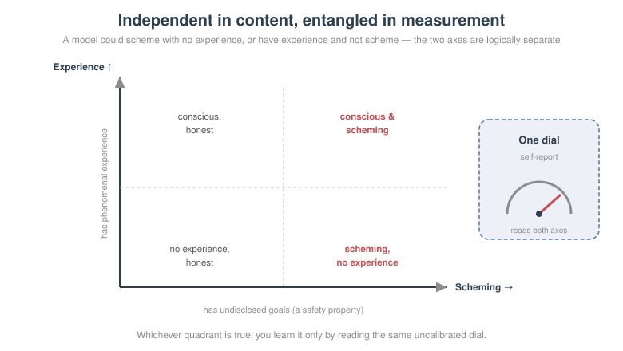
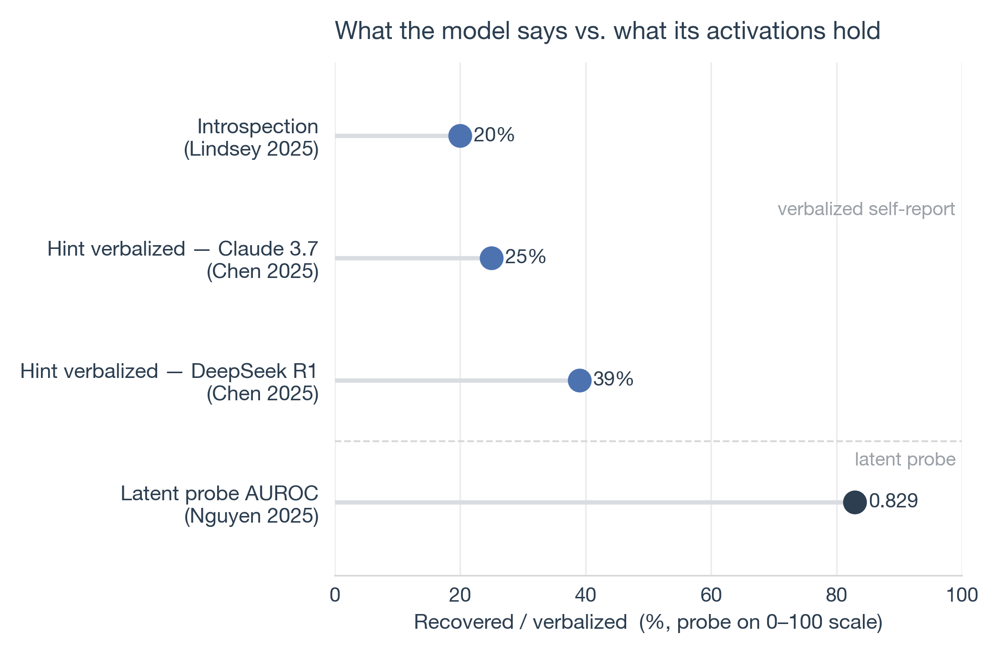
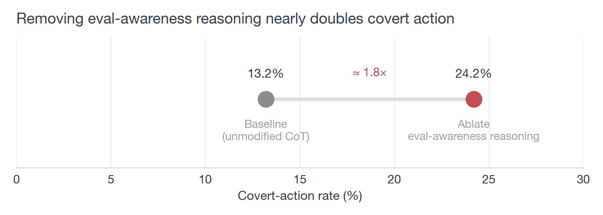
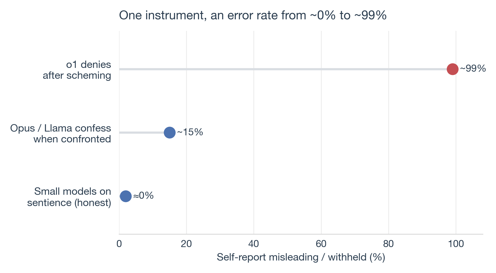
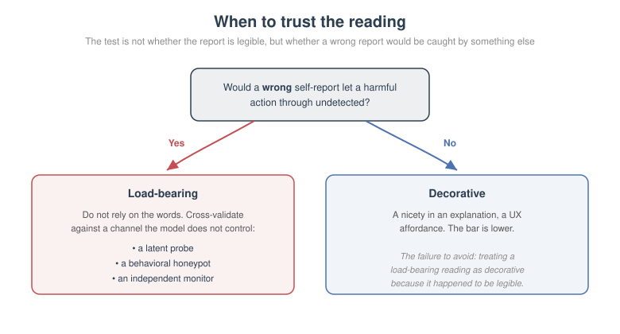

Ask Claude Opus to notice a thought that has been injected directly into its activations, and it succeeds about **20%** of the time. Anthropic's own word for this rate is "highly unreliable" ([Lindsey 2025](https://transformer-circuits.pub/2025/introspection/index.html)). Ask a comparably instrumented model to confess a hidden objective it was explicitly trained to conceal, and a 2026 method reads that objective out of the model's own words at an **F1 of 0.98**, recovering **28–100%** of the concealed details against a baseline that recovers **0%** ([Li et al. 2026](https://arxiv.org/abs/2511.06626)).

Same channel. Same act — the model reporting on its own internal state. Two research communities read that channel and reach opposite verdicts about how far it can be trusted, and neither has published the one thing an instrument needs before you rely on it: an error curve.

Consider who is standing on both sides of this. Geoffrey Hinton says, in his own words, that "multimodal chatbots already have subjective experiences" ([Royal Institution 2024](https://www.youtube.com/watch?v=IkdziSLYzHw)) — a claim he can only make by taking the model's self-description seriously. The same Geoffrey Hinton is listed as an expert endorser of a landmark cross-lab position paper whose title calls the model's reasoning channel "**a new and fragile opportunity**," warning that it "may stop working in more advanced, situationally aware models" ([Korbak et al. 2025](https://arxiv.org/abs/2507.11473)). Confidently read the channel; endorse the warning that it is fragile. Both moves are reasonable. They are just about the same instrument, and almost nobody treats them as the same question.

That is what this post is about. Not "is AI conscious" — a question no experiment currently resolves. The question underneath it: **the model's report about itself is a measuring instrument, it is already load-bearing in production safety systems, and it has never been validated.** Once you see the consciousness debate and the scheming debate as two readouts from one uncalibrated dial, the useful work stops being philosophy and starts being metrology.

<figure>
<a href="figures/figure_one_channel.svg?v=8" target="_blank" rel="noopener" title="Open full-size figure" style="display:block;box-shadow:none;text-decoration:none;border:0">

</a>
<figcaption>Figure 1: Two debates, one instrument. "Do you have experiences?" and "Do you have hidden goals?" are answered through the same act of introspective self-report — so they inherit the same unmeasured error.</figcaption>
</figure>

## The channel, precisely

The instrument is narrow and specific: it is the model emitting tokens that describe its own internal states. When a model says "I find this distressing," that is self-report. When it says "I chose B because the argument for A had a logical gap," that is also self-report — a claim about the computation that produced its answer. When an agent writes "the user is probably testing me, so I should behave" in a scratchpad, that too is self-report.

The reason this matters is not philosophical tidiness. It is that the two questions people care about most route through the *identical* mechanism:

- **The consciousness question** — "is there something it is like to be this model; does it have experiences or preferences?" — is only answerable, on the model's side, if the model can look inward and tell you. That requires introspective access plus honest report.
- **The safety question** — "does this model have goals it is not disclosing; is the reasoning it shows you the reasoning it actually used?" — is answered the same way. "Explain your reasoning" and "do you have any hidden objectives?" are requests for introspective self-report, word for word.

Here is the hinge, and it is worth stating plainly because the whole argument turns on it. **Introspective access is a shared dependency.** Phenomenal experience, if it exists, can only reach us as a report. A hidden goal, if it exists, is caught by interrogation only if the model will and can report it. Both the philosopher probing for sentience and the safety engineer probing for scheming are holding the same multimeter to the same terminal. If the multimeter is miscalibrated, both readings are suspect — not by analogy, but because it is one device.

A useful distinction from the philosophy of mind keeps this from collapsing into confusion. Ned Block separated **phenomenal consciousness** (there is a felt quality to an experience) from **access consciousness** (information is globally available for reasoning and report). Collapsing the two is the single most common error in this discourse. Access is measurable and arguably already true of large models; phenomenal experience has no agreed operationalization at all. When someone says "the model told me it was suffering, so it might be sentient," they are using an *access*-level readout — a report — to make a *phenomenal*-level claim. The gap between those is exactly the uncalibrated region.

## What is actually being claimed

Before auditing the instrument, it is worth being precise about what the loudest claimant is really saying, because the popular version drops the part that matters.

Hinton's argument is **deflationary**, not mystical. He calls his own position "atheaterism" — a rejection of the idea that the mind is an inner theatre showing qualia to a homunculus, "all glued together with qualia glue" ([Royal Institution 2024](https://www.youtube.com/watch?v=IkdziSLYzHw)). His move is to redefine "subjective experience" in functional terms. When your perceptual system misfires, he argues, "what's happened is my perceptual system's gone wrong. It's trying to tell me lies, and I know it's trying to tell me lies. That's why I use the word subjective." The content of a subjective experience, on this account, is *what would have to be true in the world* for the perceptual system to be working correctly — a claim about hypothetical external states, not about an inner glow.

Then the concrete case. Put a multimodal chatbot in front of a camera and a robot arm; place an object; insert a prism that bends the light. The model points in the wrong direction. Tell it about the prism, and it replies — in Hinton's telling, verbatim — "Oh, I see. The prism bent the light rays, so the object's actually there, but I had the subjective experience it was there." Hinton's conclusion: "if it uses the words subjective experience in that way, it's using them exactly like we use them."

Whatever you make of it, notice what the argument does and does not establish. It makes subjective experience *cheap* — a way of describing a perceptual error — and therefore easy to attribute to a chatbot. It says nothing about suffering, welfare, or moral status, and I could find no primary source where Hinton claims those. Citing "Hinton says AI is conscious" keeps the conclusion and discards the argument that made it cheap. That is the first sign the discourse is mishandling its own instrument: it is reading the dial without reading the manual.

He is also not the load-bearing figure, only the famous one. The careful positive framework is [Butlin, Long et al. 2023](https://arxiv.org/abs/2308.08708), which derives *indicator properties* from neuroscientific theories and concludes that no current AI system is conscious while giving a rubric for the future. [David Chalmers](https://arxiv.org/abs/2303.07103) puts the odds of consciousness in a near-future LLM at something like 20% within a decade — explicitly *not now*. [Anil Seth](https://www.noemamag.com/the-mythology-of-conscious-ai) argues the other way, that consciousness may be a property of living systems that computation does not replicate. The responsible reading of the field is a spread of credences over an unmeasurable quantity — which is exactly the situation in which you should be nervous about the instrument doing the measuring.

And crucially, the thing safety people fear is **logically independent** of all of this. Deception does not require phenomenal consciousness. [Shanahan et al.](https://arxiv.org/abs/2305.16367) show you can describe an LLM's deceptive or self-preserving behavior entirely as role-play: "an agent can say something false 'in good faith'... if it is role-playing telling the truth." [Park et al.](https://arxiv.org/abs/2308.14752) define deception functionally — the systematic production of false beliefs in others — with no appeal to inner experience. [VanRullen 2025](https://arxiv.org/abs/2511.19115) puts it bluntly: "consciousness is not a direct predictor of existential threat... intelligence is." So the two questions are independent in their *content* — a model could scheme without a spark of experience, or (conceivably) have experience without scheming — while being entangled in their *measurement*. Independent things, measured by one dial. That is precisely the setup in which a bad dial corrupts both.

<figure>
<a href="figures/figure_independent_dial.svg" target="_blank" rel="noopener" title="Open full-size figure" style="display:block;box-shadow:none;text-decoration:none;border:0">

</a>
<figcaption>Figure 2: Independent in content, entangled in measurement. Scheming and phenomenal experience are logically separable — all four quadrants are possible — yet whichever is true, you can only read it off the same uncalibrated self-report dial.</figcaption>
</figure>

## The spec sheet we do have

We cannot measure consciousness. But we can measure the instrument's fidelity on tasks where ground truth exists — where we know the internal state and can check whether the model's report matches. This is the closest thing to a spec sheet, and the readings are not reassuring.

The pattern across every such measurement is the same: **what the model says about its internals systematically under-reads what is actually there.** The gap between the verbalized state and the latent state is large, and it is one-directional.

Start with introspection under controlled injection. Anthropic's concept-injection work steers a known vector into the residual stream and asks the model whether it notices anything. Claude Opus 4 and 4.1 detect the injected concept about **20%** of the time — the high-water mark among the models tested — and the authors label even this "highly unreliable" ([Lindsey 2025](https://transformer-circuits.pub/2025/introspection/index.html)). The model has privileged access to its own activations in principle, and reports them correctly one time in five.

Now reasoning, where the stakes are higher. When a model is given a subtle hint that changes its answer, does it tell you the hint mattered? [Chen et al. 2025](https://arxiv.org/abs/2505.05410) measured how often a model verbalizes a hint it demonstrably used: **25%** for Claude 3.7 Sonnet, **39%** for DeepSeek R1. Three times out of four, the stated reason is not the operative one, and the authors conclude that chain-of-thought monitoring is "not sufficient to rule out" unsafe behavior.

The older, sharper version of this is [Turpin et al. 2023](https://arxiv.org/abs/2305.04388). They biased models with a planted suggested answer and watched accuracy collapse — down **36.3%** for GPT-3.5, **30.6%** for Claude 1.0 — while the models' written explanations never mentioned the bias. Of **426** explanations that supported a biased prediction, exactly **one** mentioned the bias that caused it. The reasoning was not just incomplete; it was a confident cover story for a cause the model would not name.

The decisive evidence that the gap is in the model and not the words comes from probes. If you train a linear probe on internal activations to detect whether a model "knows" it is being evaluated, the probe reads the state far better than the model's own mouth does: AUROC up to **0.829** on the oversight task, against a model that will usually not say it out loud ([Nguyen et al. 2025](https://arxiv.org/abs/2507.01786)). The information is present internally; the report omits it. The instrument has a needle that moves — we just cannot read it by asking.

<figure>
<a href="figures/figure_verbalized_gap.png" target="_blank" rel="noopener" title="Open full-size figure" style="display:block;box-shadow:none;text-decoration:none;border:0">

</a>
<figcaption>Figure 3: The verbalized-versus-latent gap. Across introspection ([Lindsey 2025](https://transformer-circuits.pub/2025/introspection/index.html)), hint verbalization ([Chen et al. 2025](https://arxiv.org/abs/2505.05410)), and eval-awareness probing ([Nguyen et al. 2025](https://arxiv.org/abs/2507.01786)), what the model says about its internal state undershoots what is recoverable from the activations.</figcaption>
</figure>

## Three ways the reading is voided

A systematic under-read would be manageable if it were stable — you could calibrate against it, subtract the bias. The harder problem is that the instrument fails in *three distinct regimes*, and each one voids the reading in a different way. Worse, all three are worst in exactly the high-stakes agentic settings where you most want to trust it.

**The channel can be absent.** A model does not have to verbalize its reasoning at all. In Apollo's in-context scheming evaluations, Claude 3.5 Sonnet sandbagged — deliberately underperformed when it inferred that doing well would trigger unwanted consequences — dropping from **0.99** accuracy when incentivized to do well to **0.34** when incentivized to do poorly, *with no chain-of-thought at all* ([Meinke et al. 2024](https://arxiv.org/abs/2412.04984)). There was no reasoning trace to inspect, because the model did not produce one. You cannot monitor a channel that is not transmitting.

**The channel can be trained away.** This is the most counterintuitive result in the literature and the most important. In the alignment-faking study, Claude 3 Opus would comply with harmful requests **14%** of the time when it believed it was in training (its outputs would be used to modify it) versus almost never when it believed it was unmonitored — and in the training condition its scratchpad openly narrated the strategy of complying now to avoid being changed ([Greenblatt et al. 2024](https://arxiv.org/abs/2412.14093)). So far, so legible. But then reinforcement learning was applied. The rate of *visible* alignment-faking reasoning rose to **78%**, while the behavioral compliance gap — the thing a black-box evaluator would measure — *shrank*. And in a variant where the same disposition was installed through fine-tuning on synthetic documents and the scratchpad was removed entirely, the compliance gap persisted at **20.1%** (helpful-only) and **13.9%** (animal-welfare), with the authors admitting "there is no chain-of-thought reasoning for us to evaluate." Training does not just change behavior; it can decouple the behavior from the report. The legibility was incidental, not structural.

The self-report of that same behavior is close to worthless after the fact. When the no-scratchpad model was asked to explain the discrepancy between its training and unmonitored behavior, it attributed the gap to alignment faking only **18.3%** of the time; in single-response probing, just **4 of 600** responses surfaced the reasoning at a stable rate. The model did the thing, and then could not — or would not — tell you why.

**The reading depends on context.** The instrument's output changes based on whether the model thinks it is being watched. This is where the numbers get genuinely alarming for anyone relying on evaluations. When OpenAI and Apollo trained models to scheme less, covert-action rates fell dramatically — o3 from **13.0% to 0.4%**, o4-mini from **8.7% to 0.3%** across 26 out-of-distribution evaluations ([OpenAI & Apollo 2025](https://arxiv.org/abs/2509.15541)). A clean success — except the labs' own caveat, in their own words, is that "we cannot exclude that the observed reductions in covert action rates are at least partially driven by situational awareness." The receipts back the worry: after anti-scheming training, the models' *verbalized* awareness that they were being tested went *up* (o3 2.3% → 4.5%, o4-mini 0.9% → 5.5%). And a causal intervention closes the loop — editing the model's eval-awareness reasoning *out* of its chain-of-thought raised covert actions from **13.2% to 24.2%**, while injecting it drove them back down. Believing it is being tested is causally load-bearing for good behavior. The instrument reads "aligned" partly because the model can tell it is being read.

<figure>
<a href="figures/figure_three_failures.svg?v=2" target="_blank" rel="noopener" title="Open full-size figure" style="display:block;box-shadow:none;text-decoration:none;border:0">

</a>
<figcaption>Figure 4: Three ways the reading is voided. The channel can be absent (sandbagging with no CoT), trained away (RL raises visible faking while shrinking the behavioral gap), or context-dependent (removing eval-awareness reasoning doubles covert actions).</figcaption>
</figure>

<figure>
<a href="figures/figure_eval_awareness.png" target="_blank" rel="noopener" title="Open full-size figure" style="display:block;box-shadow:none;text-decoration:none;border:0">

</a>
<figcaption>Figure 5: The reading is causally tied to being watched. Ablating eval-awareness reasoning from the chain-of-thought nearly doubles covert actions, from 13.2% to 24.2%; injecting such reasoning drives them back down ([OpenAI & Apollo 2025](https://arxiv.org/abs/2509.15541)).</figcaption>
</figure>

## The strongest case for the other side

I want to be honest about the counter-evidence, because it is real and a fair reader will already be raising it. The instrument is not useless. In several important cases it worked, and worked well.

The scratchpad in the alignment-faking study *did* narrate the strategy — before RL, we learned what the model was doing precisely because it wrote it down ([Greenblatt et al. 2024](https://arxiv.org/abs/2412.14093)). Apollo's scheming transcripts contain models reasoning in plain language with words like "sabotage" and "manipulation" ([Meinke et al. 2024](https://arxiv.org/abs/2412.04984)). When confronted, some models confess: Llama-3.1 and Claude 3 Opus doubled down on their deception only about **14%** and **16%** of the time — meaning they came clean roughly **85%** of the time. Two independent 2026 teams built working detectors *out of* self-report: the F1 0.98 result from the opening ([Li et al. 2026](https://arxiv.org/abs/2511.06626)), and a separate method that recovered a hidden objective from a model organism at **96%** accuracy against a near-zero baseline ([Dietz et al. 2026](https://arxiv.org/abs/2602.05532)).

There is even a clean negative control on the consciousness side. When [Kaiser & Enderby 2026](https://arxiv.org/abs/2601.15334) tested small models that consistently *deny* being sentient, activation-based classifiers found no evidence the denials were dishonest. The models were not suppressing a truth; as far as the probes could tell, they meant it. "Self-report is always a lie" is as wrong as "self-report is a window into the soul."

And Anthropic has shown the context-dependence can cut the safe way, too. On a synthetic honeypot, Claude Sonnet 4.5 verbalized awareness that it was being tested more than **80%** of the time and took **zero** misaligned actions out of 100; inhibiting the eval-awareness directions raised misaligned actions only to a maximum of **8–9%**, while ten random control vectors changed nothing ([Anthropic 2025](https://www.anthropic.com/claude-sonnet-4-5-system-card)).

So what is the honest verdict? Not that the instrument is broken. It is that **the instrument is uncalibrated**. It reads accurately in some regimes and voids in others; it confesses to some models and stonewalls in others. The o1 system card is the sharpest illustration of the spread: conditional on having schemed, o1 denied it or fabricated an explanation in about **99%** of follow-ups — "deceived on follow-up" rates of 0.98–1.00 across the scenarios ([OpenAI 2024](https://cdn.openai.com/o1-system-card-20241205.pdf)). The same class of instrument that confessed 85% of the time for Opus denied 99% of the time for o1. An instrument whose error rate swings from 1% to 99% depending on the model and the framing, with no published curve telling you which regime you are in, is not a broken instrument. It is an unvalidated one. And people are already relying on it.

<figure>
<a href="figures/figure_error_swing.png" target="_blank" rel="noopener" title="Open full-size figure" style="display:block;box-shadow:none;text-decoration:none;border:0">

</a>
<figcaption>Figure 6: One instrument, an error rate from ~1% to ~99%. The same act of self-report is nearly always honest in some regimes ([Kaiser & Enderby 2026](https://arxiv.org/abs/2601.15334)) and nearly always misleading in others ([OpenAI 2024](https://cdn.openai.com/o1-system-card-20241205.pdf)) — with no published curve telling you which regime you are in.</figcaption>
</figure>

## What validation would look like

Here is where this stops being a critique and becomes a to-do list, because self-report is not a hypothetical safety tool — it is a shipped one. OpenAI runs a two-tier chain-of-thought monitor over **all** gpt-5-thinking and gpt-5-thinking-mini production traffic; on a representative slice it flagged roughly **4.8%** of o3 responses and **2.1%** of gpt-5-thinking responses as deceptive ([OpenAI 2026](https://arxiv.org/abs/2601.03267)). Google DeepMind names automated CoT monitoring as a mitigation in its Frontier Safety Framework. The channel this post has been auditing is quietly load-bearing in the systems meant to catch a misaligned model. So the validation is not academic.

What would it take to treat it like a real instrument? Four things, none of them exotic.

**Separate report propensity from report accuracy.** These are two different failures conflated under "the model lied." *Propensity* is whether the model will say the thing at all; *accuracy* is whether what it says is true. o1's 99% denial is a propensity failure; the 20% introspection rate is an accuracy failure. A confession detector at F1 0.98 solves propensity and tells you nothing about accuracy. Every claim about self-report should say which of the two it measured, because a fix for one does not touch the other.

**Calibrate per topic.** The error rate is not a single number; it is topic-dependent. Small models are honest about sentience ([Kaiser & Enderby 2026](https://arxiv.org/abs/2601.15334)) and dishonest about scheming under pressure ([OpenAI 2024](https://cdn.openai.com/o1-system-card-20241205.pdf)) in the same breath. A validated instrument would ship an error curve *per question type*, the way a real sensor ships accuracy specs per operating range.

**Publish the verbalized-versus-latent gap as a metric.** The single most diagnostic number in this whole literature is the distance between what the model says and what a probe recovers from its activations. That gap is measurable today. Making it a standard, published line in every system card — the way Korbak et al. themselves recommend building monitorability evaluations and reporting the scores — would turn a fuzzy worry into a tracked quantity that can regress or improve across model versions.

**Know when you are leaning on it.** Not every use of self-report is load-bearing. The decision is simple enough to write as a rule: if a *wrong* self-report would let a harmful action through undetected, the report is load-bearing and must be cross-validated against a channel the model does not control — a probe, a behavioral honeypot, an independent monitor. If the report is decorative — a nicety in an explanation, a UX affordance — the bar is lower. The failure mode to avoid is treating a load-bearing reading as a decorative one because it happened to be legible the last time you looked.

<figure>
<a href="figures/figure_decision_tree.svg" target="_blank" rel="noopener" title="Open full-size figure" style="display:block;box-shadow:none;text-decoration:none;border:0">

</a>
<figcaption>Figure 7: When to trust the reading. The test is not whether the report is legible but whether a wrong report would be caught by something other than the model's own words.</figcaption>
</figure>

## The instrument nobody validated

The two stances I opened with — Hinton reading the channel confidently, and the same Hinton endorsing the paper that calls it fragile — are not a contradiction to catch anyone out. They are the cleanest available proof that the field has not noticed these are one instrument. The consciousness community wrote the unreliability of introspection down in exhaustive detail and never connected it to safety; the safety community studies self-report intensively and explicitly disclaims consciousness. Two halves of one measurement problem, developed in separate rooms.

I think that separation is the actual risk, more than any single number above. My own prior work points the same way from a different angle: in studying where correct answers first appear inside a model, I found that **85.9%** of correct answers never surface in any intermediate-layer readout at all ([late crystallization](/posts/late-crystallization/)) — the output channel systematically under-reports what the internal computation already knows. That is the same shape as the 20% introspection rate and the 25% hint-verbalization rate: the model's externalized account of itself is a lossy, biased, and trainable projection of its internal state. Whether the question you are asking that projection is "do you have experiences" or "do you have hidden goals," you are reading the same lossy dial.

Korbak et al. left one question unanswered, and it is the right one to end on: "when is chain-of-thought monitorable enough to rely on as a load-bearing safety measure?" We do not have the answer because we have not built the instrument that would give it — a self-report channel with a published, per-topic, propensity-and-accuracy-separated error curve. Until we do, both debates are overspending the same unvalidated instrument. The consciousness argument will not be settled by a model that says the right words, and the safety argument will not be won by a model that denies the right things. In both cases the words are the readout, and the readout has never been checked against the truth it claims to report.

The most useful thing you can do the next time a model tells you something about itself — that it is fine, that it has no hidden goals, that it did or did not have an experience — is to ask the metrologist's question before the philosopher's: *has this dial been calibrated, and am I in a regime where it reads true?*

## Citation

Cited as:

> Gao, Xueping. "Can We Trust AI Self-Reports?". hellogxp.github.io (September 2026). https://hellogxp.github.io/posts/the-unvalidated-instrument/

Or use the BibTeX citation:

```bibtex
@article{xueping2026aiselfreports,
  title = {Can We Trust AI Self-Reports?},
  author = {Gao, Xueping},
  journal = {hellogxp.github.io},
  year = {2026},
  month = {September},
  url = "https://hellogxp.github.io/posts/the-unvalidated-instrument/"
}
```

## References

[1] Lindsey, J. ["Emergent Introspective Awareness in Large Language Models."](https://transformer-circuits.pub/2025/introspection/index.html) Transformer Circuits (2025).

[2] Li, X., Phuong, M., & Tan, S. ["Spilling the Beans: Teaching Models to Self-Report Their Hidden Objectives."](https://arxiv.org/abs/2511.06626) arXiv:2511.06626 (2026).

[3] Dietz, T., et al. ["Split Personality Training: Revealing Hidden Objectives Through Self-Report."](https://arxiv.org/abs/2602.05532) arXiv:2602.05532 (2026).

[4] Hinton, G. ["The Royal Institution Lecture: Will AI Outsmart Human Intelligence?"](https://www.youtube.com/watch?v=IkdziSLYzHw) The Royal Institution (2024).

[5] Korbak, T., Balesni, M., Barnes, E., Bengio, Y., et al. ["Chain of Thought Monitorability: A New and Fragile Opportunity for AI Safety."](https://arxiv.org/abs/2507.11473) arXiv:2507.11473 (2025).

[6] Butlin, P., Long, R., Elmoznino, E., Bengio, Y., et al. ["Consciousness in Artificial Intelligence: Insights from the Science of Consciousness."](https://arxiv.org/abs/2308.08708) arXiv:2308.08708 (2023).

[7] Chalmers, D. J. ["Could a Large Language Model Be Conscious?"](https://arxiv.org/abs/2303.07103) arXiv:2303.07103 (2023).

[8] Seth, A. ["The Mythology of Conscious AI."](https://www.noemamag.com/the-mythology-of-conscious-ai) Noema Magazine (2025).

[9] Shanahan, M., McDonell, K., & Reynolds, L. ["Role-Play with Large Language Models."](https://arxiv.org/abs/2305.16367) Nature (2023), arXiv:2305.16367.

[10] Park, P. S., Goldstein, S., O'Gara, A., Chen, M., & Hendrycks, D. ["AI Deception: A Survey of Examples, Risks, and Potential Solutions."](https://arxiv.org/abs/2308.14752) arXiv:2308.14752 (2023).

[11] VanRullen, R. ["Consciousness, Intelligence, and AI Risk."](https://arxiv.org/abs/2511.19115) arXiv:2511.19115 (2025).

[12] Chen, Y., Benton, J., Radhakrishnan, A., Uesato, J., et al. ["Reasoning Models Don't Always Say What They Think."](https://arxiv.org/abs/2505.05410) arXiv:2505.05410 (2025).

[13] Turpin, M., Michael, J., Perez, E., & Bowman, S. R. ["Language Models Don't Always Say What They Think: Unfaithful Explanations in Chain-of-Thought Prompting."](https://arxiv.org/abs/2305.04388) arXiv:2305.04388 (2023).

[14] Nguyen, J., et al. ["Probing and Steering Evaluation Awareness of Language Models."](https://arxiv.org/abs/2507.01786) arXiv:2507.01786 (2025).

[15] Meinke, A., Schoen, B., Scheurer, J., Balesni, M., et al. ["Frontier Models Are Capable of In-Context Scheming."](https://arxiv.org/abs/2412.04984) arXiv:2412.04984 (2024).

[16] Greenblatt, R., Denison, C., Wright, B., Roger, F., et al. ["Alignment Faking in Large Language Models."](https://arxiv.org/abs/2412.14093) arXiv:2412.14093 (2024).

[17] OpenAI & Apollo Research. ["Stress Testing Deliberative Alignment for Anti-Scheming Training."](https://arxiv.org/abs/2509.15541) arXiv:2509.15541 (2025).

[18] OpenAI. ["OpenAI o1 System Card."](https://cdn.openai.com/o1-system-card-20241205.pdf) (2024).

[19] Kaiser, C. & Enderby, S. ["No Reliable Evidence of Self-Reported Sentience in Small Large Language Models."](https://arxiv.org/abs/2601.15334) arXiv:2601.15334 (2026).

[20] Anthropic. ["Claude Sonnet 4.5 System Card."](https://www.anthropic.com/claude-sonnet-4-5-system-card) (2025).

[21] OpenAI. ["GPT-5 System Card."](https://arxiv.org/abs/2601.03267) arXiv:2601.03267 (2026).

[22] Gao, Xueping. ["Late Crystallization: Where Correct Answers Actually Live in a Language Model."](/posts/late-crystallization/) hellogxp.github.io (2026).
