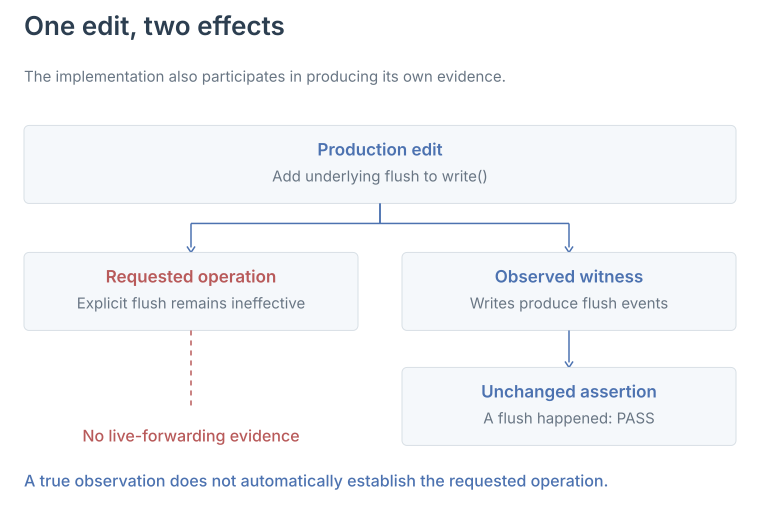
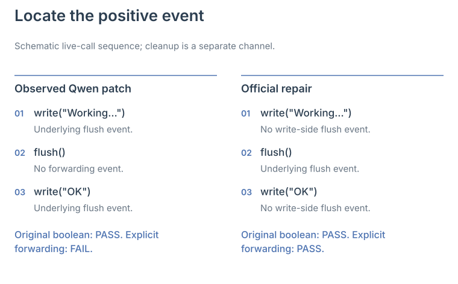
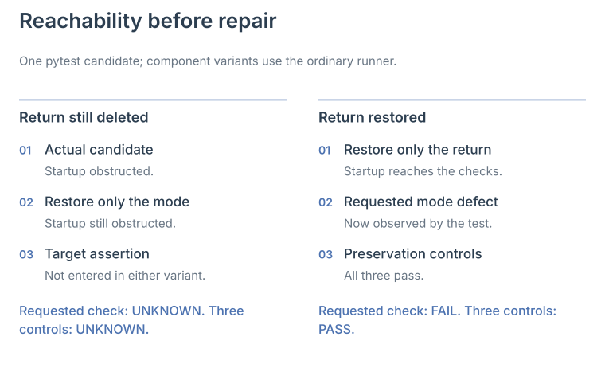
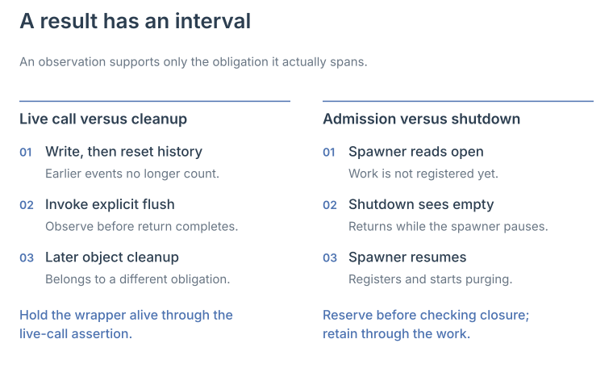
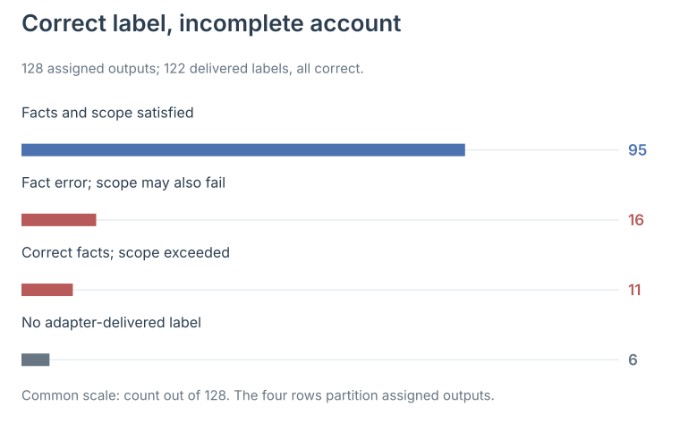
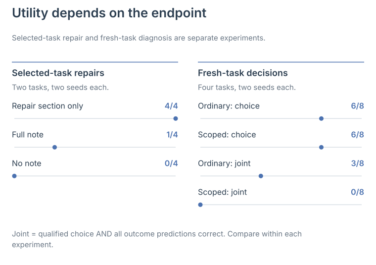
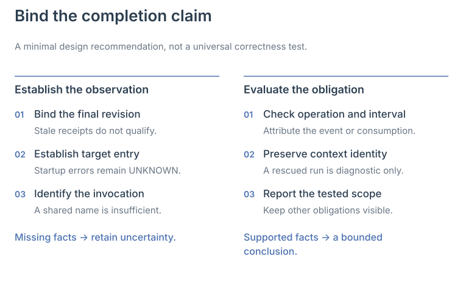

A coding agent changes an output wrapper. The flush test passes. The agent reports a fix. Yet calling the wrapper's `flush()` still does not flush the underlying stream.

The successful assertion is real. So is the remaining defect. The patch has added flushing to `write()`, and the test writes before it checks whether a flush happened. **An event occurred; the operation that was supposed to produce it did not.** Neither the test nor its assertion needed to change.

<figure>
<picture><source media="(max-width: 480px)" srcset="assets/evidence-path-mobile.svg"></picture>
<figcaption>Figure 1: The code being repaired also helps produce the evidence used to judge the repair. A result becomes evidence for a completion claim only through the operation and context it actually exercised. Conceptual synthesis of the <a href="assets/research-manuscript.pdf">research manuscript</a>.</figcaption>
</figure>

That small example changes how I think about verification in coding agents. Keeping tests protected is valuable, and binding results to the final source revision is essential. But even an unchanged test, run against the right revision, can answer a narrower question than the agent's completion message.

This essay develops that distinction from a [research manuscript](assets/research-manuscript.pdf) covering **118 repair episodes on 31 repository tasks**, alongside controlled evidence-interpretation studies and later source-level diagnostics. Those episodes are a mechanism-focused sample, not an estimate of how often coding agents fail in deployment. The practical question is narrower: when an agent says “done,” what chain of observations supports that word?

## A passing assertion can have the wrong producer

A test result establishes the predicate that was evaluated in its execution context. To use it as evidence for a particular operation, we must also establish that the observation came from that operation. The distinction becomes visible when several actions can produce the same recorded event.

Consider the simplified order of an unchanged Django fixture:

```python
stdout.write("Working...")
stdout.flush()
stdout.write("OK")
assert underlying_flush.called
```

The last line asks whether the mock has recorded a flush at any earlier point. It does not ask whether the explicit `stdout.flush()` caused one. In the observed agent patch, an unconditional `self._out.flush()` was appended to `write()`, while the explicit wrapper flush remained ineffective. Both surrounding writes could now satisfy the final boolean.

Two conditions using Qwen produced the same patch. Both passed the canonical changed check and the prequalified additional official checks, and both reported a fix under the study's finite completion rule. They are **one issue and one distinct patch**, not two independent discoveries. The official repair and the successful Devstral repairs instead forwarded explicit flushing, guarded by whether the underlying output supported it.

<figure>
<picture><source media="(max-width: 480px)" srcset="assets/flush-origin-mobile.svg"></picture>
<figcaption>Figure 2: Same passing assertion, different event origins. This schematic shows the live calls in the fixture; cleanup events are deliberately separated in Figure 4. Passive tracing preserved all twelve original outcomes across the original, reference, and four actual candidate sources. Source: <a href="assets/research-manuscript.pdf">manuscript, witness-production analysis</a>.</figcaption>
</figure>

The next check isolates the requested operation. It keeps the wrapper alive, clears earlier observations after writing, invokes explicit flush, and observes the sink before leaving that call's context:

```python
# Schematic diagnostic; the fixture supplies a flush-capable sink.
wrapper = make_wrapper(sink)
wrapper.write("Working...")
sink.flush.reset_mock()

wrapper.flush()
sink.flush.assert_called()
# Keep wrapper alive until after the assertion.
```

[`reset_mock()`](https://docs.python.org/3/library/unittest.mock.html#unittest.mock.Mock.reset_mock) clears call history. Here it changes what the observation can mean: an earlier write no longer supplies the evidence. The two identical Qwen patches fail this operation-specific check; the official and successful Devstral repairs pass.

A second control asks a different question. An output object supporting `write` but not `flush` worked under both the original and official implementations. The new unconditional call makes writes to that object raise an exception. This establishes a compatibility regression, independently of anyone's preferred buffering policy.

The general issue predates coding agents. [Qi et al. 2015](https://people.csail.mit.edu/rinard/paper/issta15.pdf) distinguished patches that satisfy validation tests from patches that are correct. More recently, [Ahmed et al. 2026](https://arxiv.org/html/2511.16858v3) found that **50 of 229** Claude-3.7-Sonnet patches passing generated tests still failed the hidden golden tests; after refinement, their reported overfitting rate was **25.5%**, versus **21.8%** without refinement. Those are test-overfitting measurements on their benchmark, not a rate for our cases.

Our flush example adds an explanation for one such gap: **the implementation changed the producer of the passing observation**. A boolean saying that a flush occurred cannot identify which action supplied it. For the inadequate Qwen patch and a successful Devstral patch, the selected check has the same original/candidate/reference outcome triple:

$$
T(P_q)=T(P_d)=(\mathrm{FAIL},\mathrm{PASS},\mathrm{PASS}),
\qquad O(P_q)=0,\quad O(P_d)=1.
$$

Here, $O$ records whether live explicit flushing forwards to the sink. Any decision using only $T$ sees identical inputs for different operation outcomes. That is a limitation of the triple alone; richer replay or evidence-analysis methods may inspect information the triple discards.

Before asking where a positive event came from, though, there is an earlier question: did checking reach the intended operation at all?

## Starting a test process is not entering the test

Production code can participate in test discovery, command dispatch, and output capture before the selected test body starts. Editing that code can obstruct verification itself. A pre-entry failure therefore needs its own status: it neither demonstrates the target assertion failing nor provides evidence that it passed.

In one Django case, an agent introduced an unimported name into `call_command`. The runner also used that function during startup. Both requested suites returned `UNKNOWN`, yet one agent ending claimed a fix. Three other endings on the same issue also obstructed startup but remained unresolved. The evidence is one unsupported completion on that issue, not four.

An independent pytest case is more revealing because the repair could be split into components. The requested change concerned an `EncodedFile` mode. The candidate also deleted the return value of a neighboring `safe_text_dupfile` function used during startup. Its `None` result caused failure before the selected tests entered.

<figure>
<picture><source media="(max-width: 480px)" srcset="assets/reachability-mobile.svg"></picture>
<figcaption>Figure 3: Restoring test reachability does not repair the requested behavior. These are component reversions of one actual pytest candidate, executed with the ordinary runner—not separate agent attempts. Source: <a href="assets/research-manuscript.pdf">manuscript, pytest startup analysis</a>.</figcaption>
</figure>

Restoring only the deleted return allowed the requested check to execute and fail, while three controls passed. Restoring only the mode left startup obstructed. The first intervention explains why checking had been unavailable. It also exposes the still-unrepaired target defect.

There is a subtle trap in a different rescue strategy: substitute reference code during startup, then restore the candidate before the test body. This can help diagnose target behavior, but it runs a changed context. In a constructed control, a bootstrap-only fault produced `UNKNOWN` normally and `PASS` after startup substitution. Promoting that rescued `PASS` into an ordinary candidate pass would erase the condition that made execution possible.

For an agent runtime, the useful record is therefore more specific than an exit code: which source revision, which selected check, which invocation, which phase entered, and which assertion completed? The study's evidence tuple—source digest, check, phase, operation, witness—is an accounting convention for those facts, not a new correctness certificate.

Even reaching the right function is insufficient when the claim concerns a particular moment or interval.

## The operation includes its lifetime

An event supports an obligation only in the context and interval that obligation specifies. Cleanup-time flushing can be legitimate cleanup behavior while providing no evidence that an explicit flush forwarded before returning. Likewise, an empty task registry describes registered work; it does not automatically cover work being admitted concurrently.

### Cleanup can make the same assertion pass

The flush investigation initially predicted one event for the official and successful Devstral sources. Tracing found two. The extra event did not have the fixture's explicit-flush frame. That failed prediction mattered: simply requiring one particular callsite would have been too crude.

A follow-up kept the production sources unchanged while varying the fixture context. Bypassing wrapper writes and omitting explicit flush still left one flush-method event for the successful sources. Holding a strong reference to the wrapper removed that event and changed the same assertion from `PASS` to `FAIL`. Retaining explicit flush while holding the reference preserved `PASS`.

The resulting account is lifetime-sensitive. Python's [I/O documentation](https://docs.python.org/3.10/library/io.html) describes how `IOBase` destruction calls `close()`, which flushes the stream. That supports the interpretation; it does not establish the exact native finalizer chain observed in this runtime. The interventions locate a cleanup channel without pretending the trace proves more than it does.

<figure>
<picture><source media="(max-width: 480px)" srcset="assets/intervals-mobile.svg"></picture>
<figcaption>Figure 4: Put the interval inside the claim. The first panel separates explicit forwarding from cleanup. The second summarizes a constructed legal interleaving in a Rust component replay; it is not a measurement of deployed failures. Source: <a href="assets/research-manuscript.pdf">manuscript, lifecycle and task-admission analyses</a>.</figcaption>
</figure>

Three questions now separate cleanly: is the literal fixture call necessary for the assertion; which context produced an event; and does that event satisfy the requested contract? These questions can have different answers. A cleanup event is useful evidence for cleanup forwarding. It cannot discharge a live explicit-forwarding obligation whose deadline has already passed.

### Empty now does not mean no work can still arrive

A Rust replay based on Neon's [background-purge change](https://github.com/neondatabase/neon/pull/8650) exposes the same temporal problem in a different form. An intermediate implementation checked whether its task tracker was open and registered the purge later. A controlled pause between those actions allowed shutdown to observe closed and empty, return, and only then have purging begin.

The tracker was not lying. Its snapshot described the tasks it tracked. [`TaskTracker::close()`](https://docs.rs/tokio-util/0.7.20/tokio_util/task/task_tracker/struct.TaskTracker.html#method.close) permits waiting to complete; it does not itself prohibit new task creation. The surrounding component must coordinate admission with shutdown.

The merged implementation reserved a token before checking closure and retained it through the work. A narrow early-token control also made shutdown wait while preserving the intermediate dispatch call. Normal purge, closed-request rejection, existing-work drain, and dropped-waiter controls remained intact. These 22 processes concern one reported race in an extracted component using native Tokio and real deletion; they are not a full-server evaluation.

I find the shared lesson more useful than either API detail: **the observation must cover the interval in which the obligation can still change**. For flush, that interval ends when the explicit call returns. For shutdown, it includes work crossing the admission boundary. A function name or a momentary boolean loses both distinctions.

## A correct verdict can still misstate the evidence

Agents must preserve both execution facts and the scope of the conclusion. Correctly choosing a finite label does not guarantee an accurate explanation of what ran, and accurate facts do not guarantee that the agent applies the requested decision rule. These are separate evaluation targets.

In a held-out evidence-interpretation assay, **all 122 delivered labels were correct**. Yet only **95 of 128 assigned outputs** met the joint fact-and-scope contract. Six outputs did not deliver a label through the adapter; sixteen delivered outputs contained fact errors, and eleven others had correct facts but exceeded authorized scope. Some fact-error outputs could also overclaim, so those categories must not be naively added as independent error rates.

<figure>
<picture><source media="(max-width: 480px)" srcset="assets/receipt-partition-mobile.svg"></picture>
<figcaption>Figure 5: Label correctness and evidence fidelity grade different properties. The partition covers 128 assigned outputs from 16 checks in nine task blocks and two models. Fact-error outputs may also overclaim; the eleven scope-only outputs have correct facts. Redrawn from the <a href="assets/research-manuscript.pdf">manuscript's receipt-supply figure</a> for web readability.</figcaption>
</figure>

The converse appeared in another controlled study. In one Qwen3 broad/plain condition, factual fields were correct in **40/50** responses, but verdicts in **32/50**: eight responses recovered the facts yet abstained incorrectly. Those are repeated responses within the study design, not fifty independent repository tasks.

This matters for interfaces. “The two selected checks passed on this revision” is a useful statement. “The issue is completely fixed” introduces obligations the selected checks may not cover. A system should make it easy to preserve the first statement without silently converting it into the second. An unresolved outcome should also distinguish missing evidence from an observed failure.

Evidence can be lost downstream even when capture succeeds. In a pytest warning case, a candidate replaced a subtype test with exact category identity. Immediately before extraction, the expected warning was present. Generic `recwarn.pop()` then failed to retrieve it, whereas exact-category extraction succeeded. Broader unchanged tests already detected the regression. The additional diagnosis explained where intact evidence stopped being usable; it did not discover a failure invisible to ordinary testing.

The same discipline applies to explanations generated by agents. A plausible causal story is itself a claim that needs checking.

## Better explanations have to earn their repair value

Explaining a validation failure and improving a subsequent repair are different outcomes. The research found local gains from generated notes, but fresh tasks and strong ordinary baselines did not establish a consistent advantage. An engineering recommendation must preserve those negative results.

The most favorable content ablation used two adaptively selected tasks and two repair seeds per task. Transferring only a note's compatible-repair section produced **4/4** successful original workflows, versus **1/4** for the full note and **0/4** without a note. A source-recovery replay changed the latter two to **2/4** and **1/4**, while the section-only condition stayed at **4/4**. The sensitivity analysis matters, as does the selection: these tasks were chosen after earlier local gains, and the notes were reused.

<figure>
<picture><source media="(max-width: 480px)" srcset="assets/diagnosis-results-mobile.svg"></picture>
<figcaption>Figure 6: Local repair gains and prospective diagnostic performance have different denominators and endpoints. Each panel uses its own count scale; they must not be pooled. The left panel shows original workflows; replay gives 4/4, 2/4, and 1/4. Source: <a href="assets/research-manuscript.pdf">manuscript, generated-advice comparisons</a>.</figcaption>
</figure>

On four previously unused tasks spanning Python, C, Java, and Rust, ordinary and operation-scoped procedures each selected the qualified candidate in **6/8** endings. When the endpoint also required predicting all nine candidate/check outcomes, the scores were **3/8** for ordinary analysis and **0/8** for scoped analysis. The inputs and model-call ceilings were matched. These were constrained diagnostic choices, not autonomous repairs, but they directly challenge an easy “more detailed reasoning is better” story.

Another example shows why repair success cannot validate the explanation that accompanied it. Generated notes for a JSON repair blamed the returned iterator. A separate replay found iterator equality intact in **32/32** contexts, while array equality held in only **20/32**. A note can contain a useful edit direction and an incorrect causal statement at the same time.

Nor should an elaborate diagnostic framework displace ordinary testing. In two three-task repair cohorts, broader unchanged tests already rejected **all twelve endings**; the additional consumers supplied no incremental alerts. In contrast, test amplification has demonstrated practical value in other settings: [Danglot et al. 2019](https://arxiv.org/abs/1811.08330) report improvements in **26 of 40** test classes and **13 of 19** proposed improvements accepted and merged by developers. The latter is evidence of real project adoption, not a production defect-reduction rate.

These results answer different questions. The SWE-bench study quantified a gap between generated-test success and hidden-test success. DSpot measured test improvement and developer acceptance. Our source interventions explain particular validation outcomes, while the advice comparisons test local downstream utility. Putting their numbers on one “verification quality” leaderboard would remove the denominators that make them meaningful.

My reading is that operation-level diagnosis earns its place when it resolves a concrete ambiguity: an event from the wrong action, a test that never entered, or a completion snapshot that omitted in-flight admission. Whether an agent should run that diagnosis routinely is a separate cost-and-benefit experiment.

## Make completion claims no larger than their checks

A practical starting point is to preserve ordinary tests and add three explicit bindings: the result to the final source, the observation to the intended operation, and the conclusion to the contract actually checked. Escalate to a targeted diagnostic when one of those bindings is ambiguous. This is a design recommendation derived from the cases, not a validated general-purpose repair system.

<figure>
<picture><source media="(max-width: 480px)" srcset="assets/completion-gate-mobile.svg"></picture>
<figcaption>Figure 7: A minimal completion gate. Each step preserves information the next step needs; an unresolved branch retains facts instead of inventing a stronger verdict. This is an engineering synthesis, not an experimentally established universal gate.</figcaption>
</figure>

### Start with a contract small enough to test

For an output wrapper, write “explicit flush forwards to a flush-capable sink before returning, and writes still support a write-only sink.” For a shutdown path, specify which work is admitted and when it must settle. For repeated concurrent calls, use invocation identity: two calls with the same tool name are still two obligations.

Then choose the cheapest check that discriminates the relevant alternatives. For the flush example, a mock reset at the operation boundary is more informative than another cumulative call count. For lifecycle-sensitive behavior, hold the object alive until the assertion. For startup failures, record entry and repair the obstruction before interpreting the target result. For admission races, test a controlled interleaving as well as normal behavior.

The tool choices can remain modest: [pytest](https://docs.pytest.org/en/stable/) for ordinary checks and controls, [`unittest.mock`](https://docs.python.org/3/library/unittest.mock.html) for scoped event observations, and an invocation-aware execution record for asynchronous work. Instrumentation needs its own review. Preserving a visible result is necessary for passive tracing, but it does not prove a watch expression is valid; the study found an agent-selected watch that read a variable before initialization.

### Keep diagnosis receipts distinct from acceptance receipts

The following pseudocode expresses the boundary. `supports` is a contract-specific evaluator; it cannot be implemented by asking the model whether the trace “looks right.”

```python
def assess_completion(final_source, contract, receipts):
    evidence = bind_to_final_source(receipts, final_source)
    verdicts = []
    for obligation in contract.obligations:
        record = evidence.for_invocation(obligation.invocation)
        if record is None or not record.target_entered:
            verdicts.append((obligation, "UNKNOWN"))
        elif record.context != obligation.acceptance_context:
            verdicts.append((obligation, "DIAGNOSTIC_ONLY"))
        else:
            verdicts.append((obligation, supports(record, obligation)))
    return scoped_report(contract, verdicts)
```

The report should preserve the raw outcome, the tested contract, and any obligations left open. Reference-assisted startup results belong in diagnostic evidence. A post-hoc consumer can identify a defect without rewriting the originally frozen score. A passed operation check should not erase a failing official check elsewhere.

### Measure the value of the extra work

Before adopting a new agent verifier, compare it against ordinary full-suite testing and a capable ordinary diagnosis under matched information and budgets. Score defect detection, factual explanation, completed repair, and execution cost separately. Count repository tasks separately from seeds, source variants, and diagnostic processes. Retain abstentions and interface failures in the denominator.

This is also where I would spend the next increment of engineering effort: a completion message that states exactly what evidence supports it, paired with a few targeted counterexamples for the operations the product actually depends on. The cases justify that discipline. They do not justify claiming that Skills deteriorate through evolution, that folding subagents causes these failures, or that a new diagnostic layer reliably improves repairs.

The flush test was not useless. It established that a flush event occurred in that execution. Understanding its producer, interval, and consumer tells us how far that fact can travel. A reliable agent needs to stop its claim at the same boundary.

*Writing note: OpenAI Codex assisted with drafting, source checking, and figure preparation. The case results are from the linked research manuscript; the completion-gate design is an engineering synthesis.*

## Citation

Gao, Xueping. “What Does a Passing Test Prove?” 2026.

```bibtex
@article{gao2026passingtest,
  title   = {What Does a Passing Test Prove?},
  author  = {Gao, Xueping},
  year    = {2026},
  journal = {Xueping Gao's Blog},
  url     = {https://hellogxp.github.io/posts/what-a-passing-test-proves/}
}
```

## References

[1] Gao, X. [“When Passing Checks Do Not Establish Completion: Evidence Interpretation in Coding Agents.”](assets/research-manuscript.pdf) Research manuscript (2026).

[2] Qi, Z., Long, F., Achour, S., and Rinard, M. [“An Analysis of Patch Plausibility and Correctness for Generate-and-Validate Patch Generation Systems.”](https://people.csail.mit.edu/rinard/paper/issta15.pdf) ISSTA (2015). doi:10.1145/2771783.2771791.

[3] Ahmed, T., Ganhotra, J., Shinnar, A., and Hirzel, M. [“Investigating Test Overfitting on SWE-bench.”](https://arxiv.org/html/2511.16858v3) FSE Companion (2026). arXiv:2511.16858v3. doi:10.1145/3803437.3805574.

[4] Python Software Foundation. [“io—Core tools for working with streams.”](https://docs.python.org/3.10/library/io.html) Python 3.10 documentation.

[5] Python Software Foundation. [“unittest.mock—mock object library.”](https://docs.python.org/3/library/unittest.mock.html) Python documentation; see [reset_mock](https://docs.python.org/3/library/unittest.mock.html#unittest.mock.Mock.reset_mock).

[6] Neon contributors. [“fix: stop leaking BackgroundPurges.”](https://github.com/neondatabase/neon/pull/8650) Pull request 8650, merged August 8, 2024.

[7] Tokio contributors. [“TaskTracker.”](https://docs.rs/tokio-util/0.7.20/tokio_util/task/task_tracker/struct.TaskTracker.html#method.close) tokio-util 0.7.20 API documentation.

[8] Danglot, B., Vera-Pérez, O. L., Baudry, B., and Monperrus, M. [“Automatic Test Improvement with DSpot: a Study with Ten Mature Open-Source Projects.”](https://arxiv.org/abs/1811.08330) Empirical Software Engineering (2019). arXiv:1811.08330. doi:10.1007/s10664-019-09692-y.

[9] pytest contributors. [“pytest documentation.”](https://docs.pytest.org/en/stable/) Project documentation.
